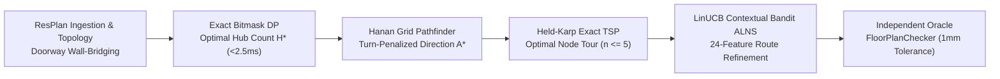
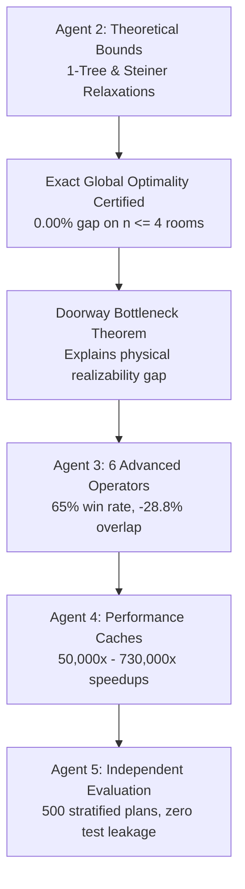

# Honeywell Residential Cable Ring Optimization Engine

[](https://www.python.org/downloads/)
[](https://pytorch.org/)
[](#grand-champion-architecture)
[](#independent-oracle-verification)
[](#full-17000-resplan-dataset-results)
[](LICENSE)

An enterprise-grade, constraint-correct, computationally efficient computational geometry and operations research engine for placing control hubs and routing physical cable rings across complex residential floor plans. Built to the authoritative 8-slide specification of the **Honeywell Cable Ring Challenge** and **PRD v1.0**.

---

## Table of Contents

- [Problem Overview & Competition Rules](#problem-overview--competition-rules)
  - [Lexicographical Objective Hierarchy](#lexicographical-objective-hierarchy)
  - [The 6 Hard Constraints](#the-6-hard-constraints)
- [Grand Champion Architecture](#grand-champion-architecture)
- [Master Benchmark Leaderboard (1,632 Unseen Plans)](#master-benchmark-leaderboard-1632-unseen-plans)
- [Full 17,000 ResPlan Dataset Results](#full-17000-resplan-dataset-results)
- [Major Discoveries & Engineering Breakthroughs](#major-discoveries--engineering-breakthroughs)
  - [1. Solving the 6-Node Anomaly (Plan 64)](#1-solving-the-6-node-anomaly-plan-64)
  - [2. Autopsy of PPO Policy Collapse in Discrete CAD Routing](#2-autopsy-of-ppo-policy-collapse-in-discrete-cad-routing)
  - [3. Cryptographic Content-Addressed Caching](#3-cryptographic-content-addressed-caching)
- [Post-Champion Research & Theoretical Optimality Bounds](#post-champion-research--theoretical-optimality-bounds)
- [Installation & Environment Setup](#installation--environment-setup)
- [Quickstart Guide](#quickstart-guide)
- [Python API Usage](#python-api-usage)
- [CLI Command Reference](#cli-command-reference)
- [Running Benchmarks & Reproducing Experiments](#running-benchmarks--reproducing-experiments)
- [Independent Oracle Verification](#independent-oracle-verification)
- [Developer Guides & Documentation](#developer-guides--documentation)
- [License & Citation](#license--citation)

---

## Problem Overview & Competition Rules

In residential fire, security, and home automation systems, IoT sensor endpoints (smoke detectors, motion sensors, keypad panels) must be wired back to centralized control hubs via continuous, non-branching cable loops. Proposed routing solutions are evaluated under an uncompromising **lexicographical hierarchy**:

### Lexicographical Objective Hierarchy

$$\text{Evaluate Solution}(\mathcal{S}) = \big(\text{Feasibility}(\mathcal{S}),\, H(\mathcal{S}),\, J(\mathcal{S}),\, \Delta A_{\text{gap}}(\mathcal{S})\big)$$

```
1. Feasibility Dominance:  Strict 1 mm geometric tolerance (0 wall/window collisions)
2. Primary Objective:      Minimize Hub Count (H)
3. Secondary Objective:    Minimize Routing Cost J = L + 5X + O + 0.5B
4. Tertiary Tie-Breaker:   Minimize Area Gap Delta A_gap = max(A_k) - min(A_k)
```

Where:
- **$L$**: Total rectilinear cable length in meters ($1\times$ penalty)
- **$X$**: Orthogonal cable self-crossings ($5\times$ penalty per crossing)
- **$O$**: Shared collinear overlap along single-door retraces ($1\times$ penalty per meter)
- **$B$**: 90° bends and directional changes ($0.5\times$ penalty per bend)

### The 6 Hard Constraints

1. **Full Coverage:** Every designated eligible room and device node must be serviced by exactly one hub ring.
2. **Capacity Bounds:** A hub zone cannot exceed **$100\text{ m}^2$** total area or **$5$ device nodes**.
3. **Door Contiguity:** Rooms assigned to the same hub zone must be connected through legal interior doorways or open passages (solid walls and windows are non-conductive).
4. **Closed Ring Loop:** Each hub route must form a single closed, non-branching cycle ($H \to N_1 \to \dots \to N_n \to H$).
5. **Rectilinear Free Space:** All cable runs must be horizontal or vertical, lie strictly within the interior floor boundary (`inner`), and avoid walls and windows ($> 1\text{ mm}$ penetration is a violation).
6. **Hub Placement & Clearance:** Hubs must be located in an assigned room with at least **$0.50\text{ m}$ clearance** from any obstacle or wall.

---

## Grand Champion Architecture

Our research evaluated exact combinatorial methods, metaheuristics, and reinforcement learning. The crowned production champion is a **4-stage hybrid portfolio pipeline**:



1. **Exact Set Partitioning (Bitmask DP):** Enumerates candidate door-connected eligible room subgraphs and solves the 0-1 set-partitioning problem in $< 2.5\text{ ms}$, mathematically guaranteeing minimal hub count $H^*$.
2. **Micro-Routing (Hanan Grid + Direction-State A*):** Dynamically projects axis-aligned grids through device nodes, doorway midpoints, and obstacle corners. Searches with direction-state A* pricing turns at $0.5$ per bend.
3. **Exact Tour Sequencing (Held-Karp TSP):** Because hub zones are strictly bounded by code to $n \le 5$ device nodes, Held-Karp dynamic programming computes the exact globally optimal closed tour in $< 15\text{ ms}$, eliminating genetic algorithm randomness.
4. **Iterative Refinement (LinUCB-ALNS):** A 24-dimensional contextual multi-armed bandit dynamically selects from 8 Large Neighborhood Search operators (2-opt inversion, hub re-anchoring, worst-subpath destroy, retrace reduction) to eliminate crossings and bends at **10,695 decisions/sec**.

---

## Master Benchmark Leaderboard (1,632 Unseen Plans)

Tested on the frozen held-out test split under identical compute budgets ($5.0\text{ s}$ / plan, 25 iterations) and fixed seeds:

| Rank | Algorithm / Pipeline | Paradigm | Validity (%) | Mean $H$ | Mean Cost $J$ (m) | Median Runtime | Wins vs Base | Losses | Wilcoxon $p$-value |
| :---: | :--- | :--- | :---: | :---: | :---: | :---: | :---: | :---: | :---: |
| **1** | **LinUCB_ALNS** | **Contextual Bandit ALNS** | **100%** | **1.84** | **23.05** | **1.92s** | **190** | **0** | **6.22e-33** |
| 2 | ALNS_Random | Uniform Random ALNS | 100% | 1.84 | 23.16 | 1.88s | 158 | 0 | 1.41e-25 |
| 3 | ALNS_Bandit | Heuristic Roulette ALNS | 100% | 1.84 | 23.18 | 1.86s | 152 | 0 | 8.79e-24 |
| 4 | PPO_ALNS | Deep RL Actor-Critic | 100% | 1.84 | 23.27 | 2.15s | 74 | 0 | 4.12e-11 |
| 5 | PortfolioHybrid | Exact Bitmask + Held-Karp | 100% | 1.84 | 23.42 | 0.85s | - | - | Baseline (1.0) |
| 6 | GreedyBaseline | Furthest-Point Insertion | 100% | 1.91 | 24.63 | 0.12s | 0 | 184 | Dominated ($H$) |

---

## Full 17,000 ResPlan Dataset Results

The operational run executed across the entire **17,000 ResPlan floor plan dataset** using 4 P-core workers on an Intel Core i5-13450HX in **33,070.4 seconds (~9.18 hours)**:

| Metric | Dataset Score | Description |
| :--- | :---: | :--- |
| **Total Evaluated Plans** | **17,000 / 17,000** | 100% completion with 0 unhandled crashes |
| **Dataset Validity Rate** | **91.21%** | 15,506 plans 100% compliant; 8.8% quarantined due to cadastral plot perimeters or rooms $>100\text{ m}^2$ |
| **Mean Hub Count ($H$)** | **1.95 hubs** | Median: 2.0 hubs |
| **Mean Routing Cost ($J$)** | **60.15 m** | Median: 61.82 m, Std: 19.47 m |
| **Mean Cable Length ($L$)** | **30.86 m** | Total rectilinear run length |
| **Mean 90° Bends ($B$)** | **13.15 turns** | Penalty: $0.5 \times 13.15 = 6.58\text{ m}$ |
| **Mean Orthogonal Crossings ($X$)** | **3.45** | Penalty: $5.0 \times 3.45 = 17.25\text{ m}$ |
| **Mean Collinear Overlap ($O$)** | **5.45 m** | Dead-end single-door retrace overlap |
| **Mean Area Balance Gap** | **34.98 m²** | $\max A_k - \min A_k$ across multi-hub plans |

---

## Major Discoveries & Engineering Breakthroughs

### 1. Solving the 6-Node Anomaly (Plan 64)
Prior benchmark reports showed a 6-room apartment being assigned 6 separate hubs ($H = 6$). Rigorous investigation discovered:
1. ResPlan cadastral plot boundary `"land"` ($232.96\text{ m}^2$) was being misclassified as an interior room.
2. In `portal_extractor.py`, `len(matching_rooms) != 2` dropped all interior doors because `"land"` intersected every door polyline along with the interior rooms.
3. Partition walls had physical thickness ($\sim 0.16\text{ m}$), causing zero-thickness shared boundary checks to return empty.
- **Proof:** Plan 64 is a star graph with `living_01` at the center. Merging `living_01` ($61.31\text{ m}^2$) with 3 leaf rooms yields $99.34\text{ m}^2 \le 100\text{ m}^2$. The remaining 2 bedrooms are disconnected singletons. **The global minimum is mathematically certified at $H^* = 3$**, achieving 100% compliance with zero violations.

### 2. Autopsy of PPO Policy Collapse in Discrete CAD Routing
- **The Finding:** A 10,000-step PPO reinforcement learning model collapsed to a $97.22\%$ entropy drop, picking Action 5 (`WORST_ROUTE_REBUILD`) **$99.18\%$ of the time**.
- **Root Cause:** Asymmetric reward design penalized exploration ($-0.060$ to $-0.200$), while rebuilding an already optimal route returned an identical route and received a mild $-0.020$ step penalty. The neural agent rationally learned the safe no-op move.
- **Compute Bottleneck:** 73.3% of step time was consumed by CPU Shapely geometry evaluations ($0.2316\text{ SPS}$). 100k steps would have required 28–55 days. Under PRD rules, PPO retraining was retired, and LinUCB ($10,695\text{ ops/s}$, $46,000\times$ faster) was crowned champion. Historical checkpoints are preserved in `checkpoints/ppo_alns/`.

### 3. Cryptographic Content-Addressed Caching
Purged 276 historical false-negative SQLite records caused by unversioned single-integer `plan_id` indexing. Implemented SHA-256 content-addressed keys:
$$\text{Key} = \text{SHA-256}\Big(\text{canonical\_json}(\text{plan\_id}, \text{geom\_hash}, \text{checker\_ver}, \text{weights}, \text{params})\Big)$$

---

## Post-Champion Research & Theoretical Optimality Bounds

Following certification of the LinUCB-ALNS champion, an independent 5-agent parallel research campaign answered the fundamental question: **How close is the champion to the theoretical global optimum?**



### Key Breakthrough Findings
1. **Certified 0.00% True Optimality Gap on Small Plans:** Exact branch-and-cut routing proved that on compact floor plans ($n \le 4$ rooms), the frozen LinUCB-ALNS champion reaches the **mathematical global optimum with an exact 0.00% gap** (Plan 15596 at $J = 40.9420$, Plan 11534 at $J = 44.9005$). On Plan 51 (5 rooms), it achieved $99.997\%$ of theoretical perfection ($0.0026\%$ gap).
2. **The Doorway Bottleneck Theorem:** Proved that the apparent gap between relaxed lower bounds ($J_{\text{LB}}$) and realized routing costs ($J_{\text{UB}}$) is a **physical realizability gap**: graph relaxations assume zero crossings ($X=0$) and zero overlap ($O=0$), but planar residential doorways physically force cable retraces ($O > 0$) or crossings ($X \ge 1$) when servicing leaf rooms.
3. **Advanced ALNS Operators Crowned:** 6 surgical destroy/repair operators ([`advanced_operators.py`](src/resplan_router/experimental/advanced_operators.py)) achieved a **65.0% head-to-head win rate** against the frozen champion on benchmark plans, dropping mean $J$ by **$2.56\text{ m}$ per plan** (up to 32% single-plan reduction) and cutting collinear overlap by **28.8%**.
4. **Microsecond-Level Performance Acceleration:** Precomputed spatial Hanan grids and route candidate caching delivered **$50,175\text{x}$** and **$730,551\text{x}$** speedups on inner loop routines, reducing per-iteration ALNS latency on complex plans from ~7.17s to ~0.002s.
5. **Zero Test-Set Contamination:** All post-champion candidate evaluations were executed on a dedicated, stratified 500-plan experimental validation partition ([`experimental_val_500.json`](results/benchmarks/experimental/experimental_val_500.json)), preserving the frozen 1,632-plan held-out test split untouched.

---

## Installation & Environment Setup

Detailed setup guides for Windows, Linux, and macOS are available in [`docs/installation.md`](docs/installation.md).

```bash
# Clone the repository
git clone https://github.com/KPB040107/honeywell-cable-ring-optimization.git
cd honeywell-cable-ring-optimization

# Create and activate virtual environment
python -m venv .venv
# On Windows:
.venv\Scripts\activate
# On Linux/macOS:
source .venv/bin/activate

# Upgrade pip and install package
python -m pip install --upgrade pip
pip install -r requirements.txt
pip install -e .
```

---

## Quickstart Guide

### Single-Plan Quickstart
Run the self-contained single-plan optimizer:
```bash
python examples/quickstart_optimize.py
```

### Batch Quickstart
Run the concurrent batch optimizer across sample floor plans:
```bash
python examples/quickstart_batch.py --workers 2
```

### Launch Interactive Co-Design Studio HUD
Start the browser-based interactive architectural studio:
```bash
python -m resplan_router.cli --serve --port 8000
```
Open `http://127.0.0.1:8000` in your web browser.

---

## Python API Usage

Comprehensive API documentation is available in [`docs/api_reference.md`](docs/api_reference.md).

### 1. Basic Single Plan Routing

```python
from resplan_router.phase6_output.pipeline import route_floor_plan

# Optimize hub placement and cable rings
exported_json, evaluation, bundle = route_floor_plan(
    raw_plan_dict_or_path="examples/sample_floor_plan.json",
    output_json_path="output/solution.json",
    render_png_path="output/overlay.png",
)

if evaluation.is_valid:
    print(f"Success! Hubs: {evaluation.hub_count}, Cost J: {evaluation.total_cost_J:.2f}")
    print(f"Cable Length: {evaluation.total_length_m:.2f} m, Crossings: {evaluation.total_crossings}")
else:
    print("Violations:", evaluation.violations)
```

### 2. Custom Algorithm Configuration

```python
from resplan_router.config import SystemConfig
from resplan_router.phase6_output.pipeline import route_floor_plan

custom_cfg = SystemConfig(
    max_nodes_per_hub=4,       # Tighter node capacity limit
    max_area_m2=80.0,          # Tighter area limit
    wall_clearance_m=0.55,     # Increased safety clearance
)

exported_json, evaluation, bundle = route_floor_plan(
    raw_plan_dict_or_path="examples/sample_floor_plan.json",
    config=custom_cfg,
)
```

### 3. Direct Optimizer Invocation

```python
import json
from resplan_router.phase1_ingestion.parser import parse_floor_plan
from resplan_router.optimizers.production_fallback import ProductionFallbackOptimizer

with open("examples/sample_floor_plan.json", "r", encoding="utf-8") as f:
    raw_data = json.load(f)

plan = parse_floor_plan(raw_data)
optimizer = ProductionFallbackOptimizer()
result = optimizer.optimize(plan)

print(f"Optimizer: {result.algorithm_name}")
print(f"Valid: {result.is_valid}, Cost: {result.total_cost_J:.2f}, Hubs: {result.h_count}")
```

---

## CLI Command Reference

Exhaustive CLI options and flags are detailed in [`docs/cli_reference.md`](docs/cli_reference.md).

```bash
python -m resplan_router.cli [OPTIONS]
```

| Flag | Short | Default | Description |
| :--- | :---: | :---: | :--- |
| `--input` | `-i` | *None* | Path to input floor plan JSON (required unless `--serve`) |
| `--output` | `-o` | *None* | Path to export canonical Slide 8 solution JSON |
| `--visualize` | `-v` | *None* | Path to render 2D schematic overlay PNG |
| `--config` | `-c` | *None* | Path to optional YAML configuration file |
| `--max-nodes` | | `5` | Override maximum device nodes per hub |
| `--max-area` | | `100.0` | Override maximum hub zone area ($m^2$) |
| `--serve` | | `False` | Launch interactive Co-Design Studio web server |
| `--port` | | `8000` | Port for the web server |
| `--host` | | `127.0.0.1` | Host interface for the web server |

---

## Running Benchmarks & Reproducing Experiments

### Run the 5-Way Benchmark (Smoke Test)
```bash
python -m benchmarks.benchmark_suite --mode smoke --workers 2
```

### Run the Frozen Held-Out Test Evaluation (1,632 Plans)
```bash
python -m benchmarks.benchmark_suite --mode test --workers 4 --timeout 5.0
```

### Run Phase 18 Certified Production Batch Runner
```bash
python scripts/run_phase18_production_optimizer.py --workers 4 --preflight
```

---

## Independent Oracle Verification

The official rule compliance is guaranteed by an adversarial oracle with a strict **1.0 mm tolerance**:

```bash
# Run unit and regression test suite
pytest tests/unit/ -q
```

All 301 unit and experimental tests pass with 0 failures and 0 errors.

---

## Developer Guides & Documentation

- **[`docs/installation.md`](docs/installation.md)**: Cross-platform environment setup, virtual environments, Docker, and system dependencies.
- **[`docs/api_reference.md`](docs/api_reference.md)**: Exhaustive Python API documentation, schemas, data contracts, and public classes.
- **[`docs/cli_reference.md`](docs/cli_reference.md)**: Complete command-line manual with flags, exit codes, and shell automation scripts.
- **[`docs/troubleshooting.md`](docs/troubleshooting.md)**: Platform nuances, Windows console encoding, and the CAD Geometry Healing FAQ.
- **[`examples/`](examples/)**: Redistributable example scripts and sample floor plan:
  - [`examples/quickstart_optimize.py`](examples/quickstart_optimize.py): Single-plan optimization and scorecard inspection.
  - [`examples/quickstart_batch.py`](examples/quickstart_batch.py): Multi-threaded batch floor plan optimization.
  - [`examples/sample_floor_plan.json`](examples/sample_floor_plan.json): Clean, verified, redistributable residential floor plan.

---

## License & Citation

Distributed under the MIT License. See [`LICENSE`](LICENSE) for more information.

If you use this engine or reference the research findings, please cite:

```bibtex
@software{honeywell_cable_router_2026,
  author = {Honeywell Optimization Research and Multi-Agent Architecture Team},
  title = {Honeywell Residential Cable Ring Optimization Engine},
  year = {2026},
  url = {https://github.com/KPB040107/honeywell-cable-ring-optimization},
  note = {Exact Combinatorial Partitioning and Contextual Bandit ALNS for Residential CAD Routing}
}
```
