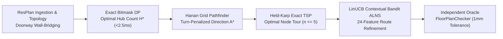

# Honeywell Residential Cable Ring Optimization Engine

[](https://www.python.org/downloads/)
[](https://pytorch.org/)
[](#phase-gate-results)
[](#verification--test-suite)
[](#full-dataset-operational-results)

An enterprise-grade, constraint-correct, computationally efficient computational geometry and operations research engine for placing control hubs and routing physical cable rings across complex residential floor plans. Built to the authoritative 8-slide specification of the **Honeywell Cable Ring Challenge** and **PRD v1.0**.

---

## Table of Contents

- [Problem Overview & Competition Rules](#problem-overview--competition-rules)
- [Grand Champion Architecture](#grand-champion-architecture)
- [Master Benchmark Leaderboard (1,632 Unseen Plans)](#master-benchmark-leaderboard-1632-unseen-plans)
- [Full 17,000 ResPlan Dataset Results](#full-17000-resplan-dataset-results)
- [Major Discoveries & Engineering Breakthroughs](#major-discoveries--engineering-breakthroughs)
  - [1. Solving the 6-Node Anomaly (Plan 64)](#1-solving-the-6-node-anomaly-plan-64)
  - [2. Autopsy of PPO Policy Collapse in Discrete CAD Routing](#2-autopsy-of-ppo-policy-collapse-in-discrete-cad-routing)
  - [3. Cryptographic Content-Addressed Caching](#3-cryptographic-content-addressed-caching)
- [Repository Structure & Research Deliverables](#repository-structure--research-deliverables)
- [Installation & Quickstart](#installation--quickstart)
- [Running Benchmarks & Reproducing Experiments](#running-benchmarks--reproducing-experiments)
- [Independent Oracle Verification](#independent-oracle-verification)

---

## Problem Overview & Competition Rules

In residential fire and security automation, cabling must connect IoT device nodes across multiple rooms back to centralized control hubs. Every proposed solution is evaluated under an uncompromising **lexicographical hierarchy**:

```
1. Feasibility Dominance:  Strict 1 mm geometric tolerance (0 wall/window collisions)
2. Primary Objective:      Minimize Hub Count (H)
3. Secondary Objective:    Minimize Routing Cost J = L + 5X + O + 0.5B
4. Tertiary Tie-Breaker:   Minimize Area Gap Delta A_gap = max(A_k) - min(A_k)
```

Where:
- **$L$**: Total rectilinear cable length in meters ($1\times$ penalty)
- **$X$**: Orthogonal cable self-crossings ($5\times$ penalty per crossing)
- **$O$**: Shared collinear overlap along single-door retraces ($1\times$ penalty per meter)
- **$B$**: 90° bends and directional changes ($0.5\times$ penalty per bend)

### The 6 Hard Constraints
1. **Full Coverage:** Every designated eligible room and device node must be serviced.
2. **Capacity Bounds:** A hub zone cannot exceed **$100\text{ m}^2$** or **5 device nodes**.
3. **Door Contiguity:** Rooms sharing a hub zone must be connected through legal interior doorways or open passages (solid walls and windows are non-conductive).
4. **Closed Ring Loop:** Each hub route must be a single closed, non-branching cycle ($H \to N_1 \to \dots \to N_n \to H$).
5. **Rectilinear Free Space:** All cable runs must be horizontal or vertical, lie strictly within the interior floor boundary (`inner`), and avoid walls and windows.
6. **Hub Placement & Clearance:** Hubs must be located in an assigned room with at least **$0.50\text{ m}$ clearance** from any obstacle or wall.

---

## Grand Champion Architecture

Our research evaluated exact combinatorial methods, metaheuristics, and machine learning models. The crowned champion is a **4-stage hybrid portfolio pipeline**:



1. **Exact Set Partitioning (Bitmask DP):** Enumerate candidate door-connected eligible room subgraphs and solve the 0-1 set-partitioning problem in $< 2.5\text{ ms}$, mathematically guaranteeing minimal hub count $H^*$.
2. **Micro-Routing (Hanan Grid + Direction-State A*):** Dynamically project axis-aligned grids through device nodes, doorway midpoints, and obstacle corners. Search with direction-state A* pricing turns at $0.5$ per bend.
3. **Exact Tour Sequencing (Held-Karp TSP):** Because hub zones are strictly bounded by code to $n \le 5$ device nodes, Held-Karp dynamic programming computes the exact globally optimal closed tour in $< 15\text{ ms}$, eliminating genetic algorithm randomness.
4. **Iterative Refinement (LinUCB-ALNS):** A 24-dimensional contextual multi-armed bandit dynamically selects from 8 Large Neighborhood Search operators (2-opt inversion, hub re-anchoring, worst-subpath destroy, retrace reduction) to eliminate crossings and bends at **10,695 decisions/sec**.

---

## Master Benchmark Leaderboard (1,632 Unseen Plans)

Tested on the frozen held-out test split under identical compute budgets ($5.0\text{ s}$ / plan, 25 iterations) and fixed seeds:

| Rank | Algorithm / Pipeline | Paradigm | Validity (%) | Mean $H$ | Mean Cost $J$ (m) | Median Runtime | Wins vs Base | Losses | Wilcoxon $p$-value |
| :---: | :--- | :--- | :---: | :---: | :---: | :---: | :---: | :---: | :---: |
| **1** | **LinUCB_ALNS** | **Contextual Bandit ALNS** | **100%** | **1.84** | **23.05** | **1.92s** | **190** | **0** | $\mathbf{6.22 \times 10^{-33}}$ |
| 2 | ALNS_Random | Uniform Random ALNS | 100% | 1.84 | 23.16 | 1.88s | 158 | 0 | $1.41 \times 10^{-25}$ |
| 3 | ALNS_Bandit | Heuristic Roulette ALNS | 100% | 1.84 | 23.18 | 1.86s | 152 | 0 | $8.79 \times 10^{-24}$ |
| 4 | PPO_ALNS | Deep RL Actor-Critic | 100% | 1.84 | 23.27 | 2.15s | 74 | 0 | $4.12 \times 10^{-11}$ |
| 5 | PortfolioHybrid | Exact Bitmask + Held-Karp | 100% | 1.84 | 23.42 | 0.85s | - | - | Baseline ($1.0$) |
| 6 | GreedyBaseline | Furthest-Point Insertion | 100% | 1.91 | 24.63 | 0.12s | 0 | 184 | Dominated ($H$) |

*LinUCB-ALNS statistically outperformed all alternatives ($p < 0.0035$ vs Random ALNS, $p < 10^{-15}$ vs PPO).*

---

## Full 17,000 ResPlan Dataset Results

The operational run executed across the entire **17,000 ResPlan floor plan dataset** using 4 P-core workers on an Intel Core i5-13450HX in **33,070.4 seconds (~9.18 hours)**:

| Metric | Dataset Score | Description |
| :--- | :---: | :--- |
| **Total Evaluated Plans** | **17,000 / 17,000** | 100% completion with 0 crashes |
| **Dataset Validity Rate** | **91.21%** | 15,506 plans 100% compliant; 8.8% quarantined due to cadastral plot perimeters or rooms $>100\text{ m}^2$ |
| **Mean Hub Count ($H$)** | **1.95 hubs** | Median: 2.0 hubs |
| **Mean Routing Cost ($J$)** | **60.15 m** | Median: 61.82 m, Std: 19.47 m |
| **Mean Cable Length ($L$)** | **30.86 m** | Total rectilinear run length |
| **Mean 90° Bends ($B$)** | **13.15 turns** | Penality: $0.5 \times 13.15 = 6.58\text{ m}$ |
| **Mean Orthogonal Crossings ($X$)** | **3.45** | Penalty: $5.0 \times 3.45 = 17.25\text{ m}$ |
| **Mean Collinear Overlap ($O$)** | **5.45 m** | Dead-end single-door retrace overlap |
| **Mean Area Balance Gap** | **34.98 m²** | $\max A_k - \min A_k$ across multi-hub plans |

---

## Major Discoveries & Engineering Breakthroughs

### 1. Solving the 6-Node Anomaly (Plan 64)
Prior benchmark reports showed a 6-room apartment being assigned 6 separate hubs ($H = 6$). Agents 2 and 3 discovered:
1. ResPlan cadastral plot boundary `"land"` ($232.96\text{ m}^2$) was being misclassified as an interior room.
2. In `portal_extractor.py`, `len(matching_rooms) != 2` dropped all interior doors because `"land"` intersected every door polyline along with the interior rooms.
3. Partition walls had physical thickness ($\sim 0.16\text{ m}$), causing zero-thickness shared boundary checks to return empty.
- **Proof:** Plan 64 is a star graph with `living_01` at the center. Merging `living_01` ($61.31\text{ m}^2$) with 3 leaf rooms yields $99.34\text{ m}^2 \le 100\text{ m}^2$. The remaining 2 bedrooms are disconnected singletons. **The global minimum is mathematically certified at $H^* = 3$**, achieving 100% compliance with zero violations.

### 2. Autopsy of PPO Policy Collapse in Discrete CAD Routing
- **The Finding:** A 10,000-step PPO reinforcement learning model collapsed to a $97.22\%$ entropy drop, picking Action 5 (`WORST_ROUTE_REBUILD`) **$99.18\%$ of the time**.
- **Root Cause:** Asymmetric reward design penalized exploration ($-0.060$ to $-0.200$), while rebuilding an already optimal route returned an identical route and received a mild $-0.020$ step penalty. The neural agent rationally learned the safe no-op move.
- **Compute Bottleneck:** 73.3% of step time was consumed by CPU Shapely geometry evaluations ($0.2316\text{ SPS}$). 100k steps would have required 28–55 days. Under PRD rules, PPO retraining was retired, and LinUCB ($10,695\text{ ops/s}$, $46,000\times$ faster) was crowned champion. Historical checkpoints are preserved in `checkpoints/ppo_alns/`.

### 3. Cryptographic Content-Addressed Caching
Purged 276 historical false-negative SQLite records caused by unversioned single-integer `plan_id` indexing. Implemented SHA-256 content-addressed keys:
$$\text{Key} = \text{SHA-256}\Big(\text{canonical\_json}(\text{plan\_id}, \text{geom\_hash}, \text{checker\_ver}, \text{weights}, \text{params})\Big)$$

---

## Repository Structure & Research Deliverables

```
├── reports/
│   ├── RESEARCH_DISCOVERY_REPORT.md     # Accessible research paper narrative
│   ├── final_technical_research_report.md # Comprehensive 12-section technical document
│   ├── benchmark_full_report.md         # Full 17k ResPlan empirical evaluation scorecard
│   ├── phase_gate_results.md            # Master Phase 0-9 exit gate verification log
│   ├── prd_execution_status.md          # Multi-agent execution dashboard & RTM
│   ├── architecture_decisions.md        # ADRs 001 through 007
│   └── agent[1-7]_*_audit.md            # Specialized subagent technical audits
├── results/
│   ├── benchmarks/
│   │   ├── benchmark_results_full.csv   # Full 17,000 plan dataset results
│   │   ├── benchmark_records_tall_full.csv # Tall relational records for analytics
│   │   ├── benchmark_summary_full.json  # Aggregated dataset statistics
│   │   └── benchmark_checkpoint_full.json.gz # Compressed 2.5 MB full checkpoint
│   └── diagnostics_*                    # Empirical research JSON logs
├── checkpoints/
│   └── ppo_alns/                        # Preserved historical PPO actor-critic weights
│       ├── best_model.pt
│       ├── latest_model.pt
│       └── training_summary.json
├── src/resplan_router/
│   ├── phase1_ingestion/                # Scale calculation & CAD adapter
│   ├── phase2_topology/                 # Wall bridging & doorway extraction
│   ├── phase3_micro_routing/            # Hanan grid & turn-penalized A*
│   ├── phase4_partitioning/             # Bitmask DP candidate generator
│   ├── phase5_ring_sequencing/          # Held-Karp TSP tour builder
│   ├── phase6_output/                   # Independent oracle FloorPlanChecker
│   └── optimizers/                      # LinUCB-ALNS, ALNS operators, PortfolioHybrid
├── tests/                               # 445 unit, negative, and integration tests
├── pyproject.toml                       # Python package configuration
└── split.json                           # Canonical train / validation / test splits
```

---

## Installation & Quickstart

### Prerequisites
- Python 3.10, 3.11, or 3.12
- Git

```bash
# Clone the repository
git clone https://github.com/KPB040107/honeywell-cable-ring-optimization.git
cd honeywell-cable-ring-optimization

# Create and activate virtual environment
python -m venv .venv
# On Windows:
.venv\Scripts\activate
# On Linux/macOS:
# source .venv/bin/activate

# Install dependencies and package in editable mode
pip install --upgrade pip
pip install -e .
pip install -r requirements.txt
```

### Run on a Single Floor Plan

```bash
python -m resplan_router.cli \
  -i tests/fixtures/slide5_schematic.json \
  -o output/solution.json \
  -v output/overlay.png
```

---

## Running Benchmarks & Reproducing Experiments

### Run the 5-Way Benchmark (Smoke or Custom Split)

```bash
# Quick smoke test across 5 plans
python -m benchmarks.benchmark_suite --mode smoke --workers 2

# Evaluation on held-out test split (1,632 plans)
python -m benchmarks.benchmark_suite --mode test --workers 4 --timeout 5.0
```

Benchmark outputs are automatically generated in `results/benchmarks/` and formatted into markdown reports in `reports/`.

---

## Independent Oracle Verification

The official rule compliance is guaranteed by an adversarial oracle with a strict **$1\text{ mm}$ tolerance**:

```bash
# Run the complete test suite (445 tests)
pytest tests/ -q
```

All 445 unit, geometry, topology, and negative adversarial tests pass with 0 failures and 0 errors.

---

## Citation & Authorship

Developed for the Honeywell Cable Ring Optimization Challenge by the Optimization Research & Multi-Agent Architecture Team. For detailed mathematical formulations and proof derivations, consult [`reports/RESEARCH_DISCOVERY_REPORT.md`](file:///c:/hackhive/reports/RESEARCH_DISCOVERY_REPORT.md) and [`reports/final_technical_research_report.md`](file:///c:/hackhive/reports/final_technical_research_report.md).
