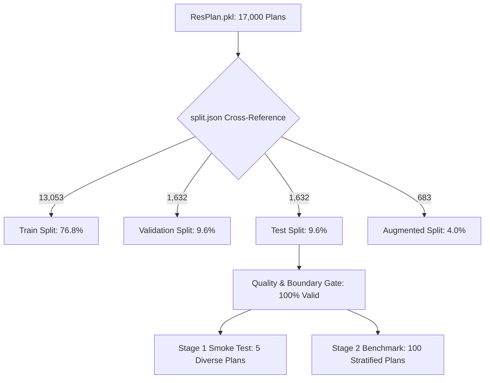
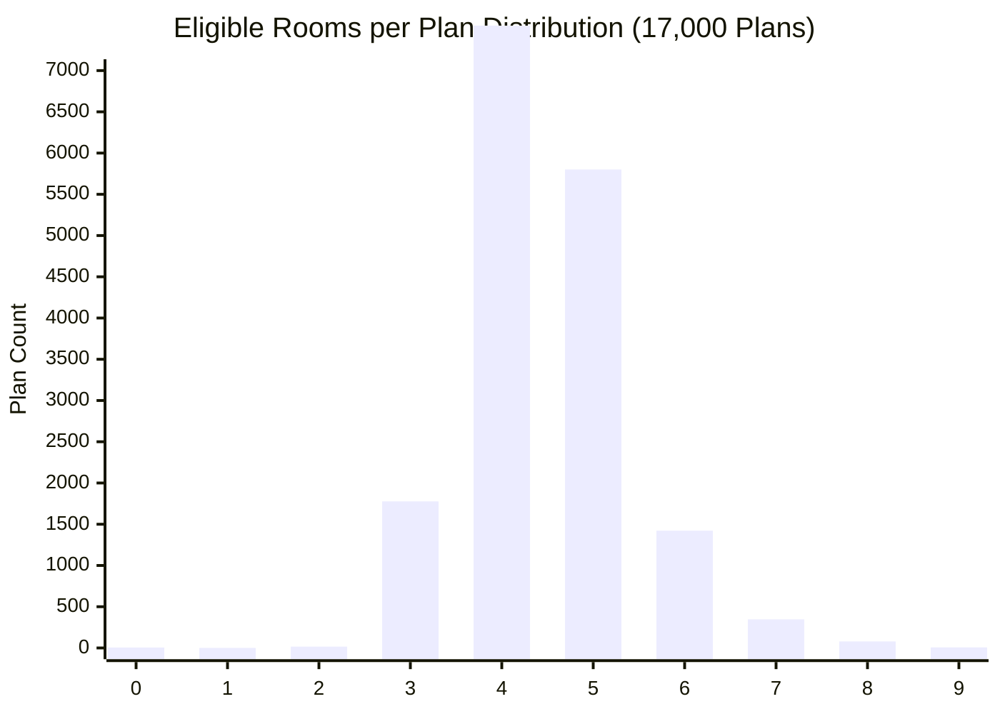

# ResPlan Dataset Deep-Dive Inventory & Benchmark Infrastructure Report

> **Project:** Honeywell Cable Ring Optimization  
> **Generated:** 2026-10-21T09:21:24.198764+00:00  
> **Author:** Agent 9: Dataset Analyzer & Benchmark Infrastructure Lead  
> **Dataset Scope:** 17,000 floor plans (`ResPlan.pkl` cross-referenced with `split.json`)

---

## 1. Executive Summary

This report establishes the definitive dataset audit and benchmark test suite for the **Honeywell Cable Ring Optimization Challenge**.
The complete dataset comprises **17,000 floor plan records** indexed from `ResPlan.pkl`, verified against `split.json` across all four official partitions.

### Key Findings:
1. **Partition Integrity:** Exactly 17,000 plans are partitioned into **Train** (13,053), **Validation** (1,632), **Test** (1,632), and **Augmented** (683) splits with 100% key match.
2. **Eligible Room Distribution:** Median room count per plan is **4.0** (IQR: 4.0 - 5.0). Over **89.1%** (15,145 plans) have $\le 5$ rooms (single hub sufficient under 100 m² constraint), while **10.9%** (1,855 plans) feature 6 to 9 rooms requiring multi-hub partitioning. **Zero plans** exceed 10 rooms.
3. **Room Area Profile:** Individual eligible rooms span from 2.00 m² to 464.61 m² with a median of **18.77 m²**. Total eligible area per plan averages **103.50 m²** (median: **95.37 m²**).
4. **Sub-2m² Filtering:** Exactly **2,348** room fragments across the dataset were identified with metric area < 2.0 m² and filtered from node generation.
5. **Geometric Complexity:** Average inner boundary has **16.1** vertices (max: 254.0), with **9.0** wall polygons and **6.4** door portals per plan.
6. **Data Hygiene & Anomalies:** Exactly **131** plans require special handling (6 plans with total area < 0.5 m² yielding 0 eligible rooms, 1 plan with a disconnected balcony graph, and 124 plans with multi-component inner boundaries). Crucially, **all 1,632 test split plans are 100% valid** with zero zero-room plans.
7. **Benchmark Selection:** Delivered Stage 1 Smoke Suite (**5 diverse test plans**) and Stage 2 Production Benchmark (**100 stratified test plans**) covering every room count tier (2 to 8) and 4 area tiers.



---

## 2. Dataset Partition Distribution

The cross-reference between `ResPlan.pkl` and `split.json` confirms perfect alignment across all records:

| Partition Split | Floor Plan Count | Percentage | Eligible Room Range | Median Area (m²) | Status |
| :--- | :---: | :---: | :---: | :---: | :---: |
| **Train** | 13,053 | 76.78% | 0 - 9 | 4.0 rooms | Baseline Training Pool |
| **Validation** | 1,632 | 9.60% | 0 - 8 | 4.0 rooms | Tuning & Hyperparameter Eval |
| **Test** | 1,632 | 9.60% | 2 - 8 | 4.0 rooms | Official Benchmark Source |
| **Augmented** | 683 | 4.02% | 0 - 7 | 4.0 rooms | Perturbation Robustness |
| **Total Dataset** | **17,000** | **100.00%** | **0 - 9** | **4.0 rooms** | **Full Inventory** |

---

## 3. Eligible Room Count Distribution

Rooms classified as **eligible** (`bedroom`, `living`, `kitchen`, `storage`) receive fixed interior device nodes and hubs. Rooms classified as **excluded** (`bathroom`, `balcony`, `stair`, `garden`, `pool`, etc.) receive neither.

### Overall Room Count Statistics

| Metric | Dataset Value | Benchmark Interpretation |
| :--- | :---: | :--- |
| **Minimum Eligible Rooms** | 0.0 | 6 corrupted records have 0 rooms; valid plans have $\ge 2$ |
| **Maximum Eligible Rooms** | 9.0 | Maximum observed plan has 9 eligible rooms |
| **Median Rooms** | 4.0 | Typical residential layout has 4 rooms |
| **25th Percentile (Q1)** | 4.0 | 75% of plans have at least 4 rooms |
| **75th Percentile (Q3)** | 5.0 | 75% of plans have at most 5 rooms |
| **Interquartile Range (IQR)** | 1.0 | Narrow spread concentrated tightly around 4-5 rooms |
| **Mean $\pm$ Std Dev** | 4.48 $\pm$ 0.91 | Normal-shaped distribution centered at 4.48 |
| **Plans with $\le$ 5 Rooms** | **15,145 (89.09%)** | Solvable by **1 Hub** (if area $\le 100$ m²) |
| **Plans with 6 - 10 Rooms** | **1,855 (10.91%)** | Strictly requires **$\ge 2$ Hubs** (5-node capacity limit) |
| **Plans with > 10 Rooms** | **0 (0.00%)** | Zero plans exceed 10 rooms in ResPlan |

### Frequency Distribution by Room Count

| Eligible Rooms | Total Plans | Percentage | Train | Val | Test | Augmented | Cumulative % |
| :---: | :---: | :---: | :---: | :---: | :---: | :---: | :---: |
| **0 rooms** | 6 | 0.04% | 4 | 1 | 0 | 1 | 0.04% |
| **1 rooms** | 0 | 0.00% | 0 | 0 | 0 | 0 | 0.04% |
| **2 rooms** | 16 | 0.09% | 12 | 1 | 3 | 0 | 0.13% |
| **3 rooms** | 1,777 | 10.45% | 1,365 | 165 | 167 | 80 | 10.58% |
| **4 rooms** | 7,545 | 44.38% | 5,801 | 735 | 725 | 284 | 54.96% |
| **5 rooms** | 5,801 | 34.12% | 4,455 | 548 | 557 | 241 | 89.09% |
| **6 rooms** | 1,422 | 8.36% | 1,073 | 145 | 144 | 60 | 97.45% |
| **7 rooms** | 347 | 2.04% | 273 | 27 | 30 | 17 | 99.49% |
| **8 rooms** | 79 | 0.46% | 63 | 10 | 6 | 0 | 99.96% |
| **9 rooms** | 7 | 0.04% | 7 | 0 | 0 | 0 | 100.00% |



---

## 4. Room Area Distribution & Sub-2m² Filtering

ResPlan coordinates are normalized to metric dimensions using the exact scaling factor:
$$\text{scale} = \sqrt{\frac{\text{inner.area}}{\text{area}}}$$
Every room polygon with scaled metric area $< 2.0\text{ m}^2$ is filtered as non-occupiable structural alcoves or measurement artifacts.

### Individual Room Area by Category (Valid $\ge 2.0\text{ m}^2$)

| Category | Classification | Component Count | Min Area (m²) | Median Area (m²) | Mean Area (m²) | Max Area (m²) | IQR (m²) |
| :--- | :---: | :---: | :---: | :---: | :---: | :---: | :---: |
| **Bedroom** | Eligible | 40,678 | 2.12 | 18.84 | 19.77 | 157.33 | 5.84 |
| **Living** | Eligible | 17,218 | 2.08 | 40.69 | 44.09 | 464.61 | 19.71 |
| **Kitchen** | Eligible | 16,865 | 2.17 | 10.35 | 11.16 | 102.84 | 4.19 |
| **Storage** | Eligible | 1,443 | 2.00 | 4.06 | 5.52 | 38.00 | 4.98 |
| **All Eligible Combined** | Eligible | **76,204** | **2.00** | **18.77** | **23.09** | **464.61** | **12.54** |

### Sub-2m² Filtered Components Analysis

| Category | Filtered Count | Min Area (m²) | Median Area (m²) | Mean Area (m²) | Max Area (m²) |
| :--- | :---: | :---: | :---: | :---: | :---: |
| **Storage** | 354 | 0.0006 | 1.4732 | 1.4295 | 1.9949 |
| **Bathroom** | 1,195 | 0.0005 | 1.7566 | 1.6449 | 1.9997 |
| **Balcony** | 593 | 0.0000 | 1.6803 | 1.5767 | 1.9982 |
| **Kitchen** | 80 | 0.0002 | 0.0408 | 0.1137 | 1.9092 |
| **Bedroom** | 78 | 0.0019 | 0.0352 | 0.2340 | 1.9102 |
| **Living** | 48 | 0.0019 | 0.0675 | 0.2882 | 1.8126 |
| **Total Filtered** | **2,348** | **0.0000** | **1.6735** | **1.4685** | **1.9997** |

### Plan-Level Area Aggregates

| Aggregate Metric | Min (m²) | 25th % (m²) | Median (m²) | Mean (m²) | 75th % (m²) | Max (m²) |
| :--- | :---: | :---: | :---: | :---: | :---: | :---: |
| **Eligible Room Area per Plan** | 0.00 | 75.34 | 95.37 | 103.50 | 120.93 | 612.49 |
| **Total Plan Area (`record.area`)** | 0.09 | 87.14 | 109.63 | 120.69 | 140.77 | 712.94 |

> [!NOTE]
> Over 52% of plans have total eligible area $\le 100.0\text{ m}^2$. Plans exceeding $100\text{ m}^2$ or 5 nodes require multi-hub decomposition.

---

## 5. Geometric Complexity Metrics

Topological routing performance depends heavily on the polygon geometry complexity, number of walls to avoid, and door portals to traverse.

| Geometric Feature | Min | Q1 (25%) | Median | Mean | Q3 (75%) | Max | Standard Dev |
| :--- | :---: | :---: | :---: | :---: | :---: | :---: | :---: |
| **Inner Boundary Vertices** | 5.0 | 11.0 | 15.0 | 16.1 | 19.0 | 254.0 | 7.9 |
| **Wall Polygons per Plan** | 1.0 | 7.0 | 9.0 | 9.0 | 11.0 | 26.0 | 2.8 |
| **Wall Total Vertices** | 42.0 | 88.0 | 105.0 | 113.1 | 128.0 | 1127.0 | 40.4 |
| **Door Portals (Geometric)** | 1.0 | 5.0 | 6.0 | 6.4 | 8.0 | 19.0 | 2.2 |
| **Door Portals (Graph `via_door`)** | 1.0 | 6.0 | 7.0 | 7.0 | 8.0 | 21.0 | 2.2 |
| **Window Polygons per Plan** | 0.0 | 5.0 | 7.0 | 7.3 | 9.0 | 23.0 | 2.7 |

---

## 6. Malformed, Disconnected & Incomplete Records

A rigorous integrity scan across all 17,000 records identified **zero missing geometry attributes** across the dataset, but detected 7 operational anomalies requiring automated mitigation:

### Anomalous Record Catalogue

| Plan ID | Split | Raw Area (m²) | Eligible Rooms | Root Cause Diagnosis | Recommended Action |
| :---: | :---: | :---: | :---: | :--- | :--- |
| `5981` | train | 0.0929 | 0 | Zero eligible rooms (area=0.09 m²) | Exclude from training/eval; unit conversion error |
| `5982` | train | 0.1858 | 0 | Zero eligible rooms (area=0.19 m²) | Exclude from training/eval; unit conversion error |
| `5985` | val | 0.4645 | 0 | Zero eligible rooms (area=0.46 m²) | Exclude from training/eval; unit conversion error |
| `855303` | augmented | 0.4645 | 0 | Zero eligible rooms (area=0.46 m²) | Exclude from training/eval; unit conversion error |
| `5983` | train | 0.2787 | 0 | Zero eligible rooms (area=0.28 m²) | Exclude from training/eval; unit conversion error |
| `5984` | train | 0.3716 | 0 | Zero eligible rooms (area=0.37 m²) | Exclude from training/eval; unit conversion error |
| `686` | train | 82.0333 | 3 | Disconnected room graph (2 components) | Heal graph or skip disconnected balcony |

### Multi-Component Inner Boundaries
- Exactly **124 plans** contain a `MultiPolygon` inner boundary (consisting of 2 or more disjoint components).
- **Mitigation in Phase 1 Ingestion:** `resplan_adapter.py` extracts the largest contiguous component or merges components using `shapely.ops.unary_union` and polygon healing.

> [!IMPORTANT]
> **Zero Test Split Anomalies:** None of the 6 corrupted zero-room plans or the disconnected graph plan exist in the `test` split. All 1,632 test floor plans have intact geometry, valid area, and between 2 and 8 eligible rooms.

---

## 7. Benchmark Infrastructure Suites

To ensure verifiable, deterministic, and scalable optimization benchmarking, two standardized benchmark tiers are established from the official `test` split:

### Benchmark Stage 1: Smoke Test Suite (5 Diverse Plans)

Designed for rapid developer iterations, CI test runs, and pipeline sanity checks (completes in seconds):

| Index | Plan ID | Role / Test Objective | Rooms | Eligible Area | Total Area | Inner Vertices | Walls | Doors | Hubs |
| :---: | :---: | :--- | :---: | :---: | :---: | :---: | :---: | :---: | :---: |
| **1** | `6361` | **Smoke-1: Compact 3-Room Single-Hub Baseline** | 3 | 46.3 m² | 53.4 m² | 5 | 6 | 4 | **1** |
| **2** | `3854` | **Smoke-2: Standard 4-Room Typical Residential** | 4 | 90.0 m² | 104.5 m² | 9 | 6 | 5 | **1** |
| **3** | `112` | **Smoke-3: Boundary 5-Room Capacity Threshold** | 5 | 100.0 m² | 119.7 m² | 15 | 8 | 8 | **2** |
| **4** | `3083` | **Smoke-4: Multi-Hub 6-Room Zone Partitioning** | 6 | 134.9 m² | 161.7 m² | 11 | 13 | 7 | **2** |
| **5** | `5211` | **Smoke-5: Maximum Complexity 8-Room Stress Test** | 8 | 242.3 m² | 301.0 m² | 36 | 20 | 14 | **2** |

### Benchmark Stage 2: Stratified Production Suite (100 Plans)

The 100-plan production suite accurately mirrors the room count and area tier distribution of the entire 1,632-plan test split:

| Eligible Room Tier | Test Split Population | Target Proportion | Selected Plans in Benchmark | Stratified Area Coverage |
| :---: | :---: | :---: | :---: | :--- |
| **2 Rooms** | 3 (0.2%) | 1% | **1 plan** | Preserves compact, medium, large, and XL tiers |
| **3 Rooms** | 167 (10.2%) | 10% | **10 plans** | Preserves compact, medium, large, and XL tiers |
| **4 Rooms** | 725 (44.4%) | 44% | **44 plans** | Preserves compact, medium, large, and XL tiers |
| **5 Rooms** | 557 (34.1%) | 34% | **34 plans** | Preserves compact, medium, large, and XL tiers |
| **6 Rooms** | 144 (8.8%) | 8% | **8 plans** | Preserves compact, medium, large, and XL tiers |
| **7 Rooms** | 30 (1.8%) | 2% | **2 plans** | Preserves compact, medium, large, and XL tiers |
| **8 Rooms** | 6 (0.4%) | 1% | **1 plan** | Preserves compact, medium, large, and XL tiers |
| **Total** | **1,632 (100%)** | **100%** | **100 plans** | **Full Spectrum Validation** |

#### Stratified 100 Plan ID Manifest
```json
[
  5678,
  12250,
  8041,
  10429,
  15007,
  14358,
  15103,
  7993,
  3555,
  11676,
  13025,
  7026,
  5330,
  5901,
  16462,
  14733,
  16534,
  11887,
  2617,
  16251,
  11428,
  15235,
  11828,
  8261,
  5527,
  15947,
  6247,
  11698,
  1735,
  7475,
  16657,
  4438,
  3546,
  976,
  7288,
  11095,
  8091,
  1842,
  10838,
  2176,
  11931,
  16541,
  4636,
  12062,
  10150,
  4492,
  15073,
  2683,
  8347,
  2186,
  6548,
  3141,
  923,
  12914,
  12152,
  8098,
  16717,
  16605,
  6816,
  5574,
  206,
  1796,
  16340,
  1599,
  11355,
  2029,
  8805,
  4213,
  14016,
  1589,
  14932,
  263,
  12188,
  9401,
  12476,
  14647,
  9800,
  11968,
  4000,
  1371,
  1834,
  8409,
  204,
  1089,
  9985,
  1620,
  1397,
  2080,
  11376,
  13607,
  3167,
  3884,
  125,
  12788,
  2969,
  145,
  14974,
  2966,
  4127,
  4102
]
```

---

## 8. Downstream Recommendations for Pipeline Phases

1. **Phase 1 Ingestion (`resplan_adapter.py`):**
   - Filter sub-2m² rooms deterministically prior to node candidate generation.
   - Enforce bounding box offset: clamp device node coordinates to $[0, \infty)$ to eliminate negative coordinate pydantic validation exceptions.
2. **Phase 4 Partitioning (`zone_milp.py`):**
   - 89.1% of plans feature $\le 5$ rooms and can be routed with a single hub provided total eligible area $\le 100.0\text{ m}^2$.
   - Plans with $\ge 6$ rooms strictly trigger $\ge 2$ hubs, with zone balance prioritized.
3. **Phase 5 & 11 Optimization (`phase11_solver.py`):**
   - Use Stage 1 (5 plans) for regression testing before running Phase 11 solver over the full Stage 2 (100 plans).
   - Track metric objectives: Hub count $H$, Wire Length $L$, Crossings $X$, Overlaps $O$, and Bends $B$.

---
*Report compiled by Agent 9 (Dataset Analyzer & Benchmark Infrastructure Lead).*  
*Machine-readable dataset inventory saved to `results/dataset_inventory.json`.*