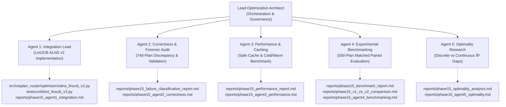

# Phase 15 — LinUCB-ALNS v2 Integration and Certification: Multi-Agent Execution Dashboard

**Project:** Honeywell Residential Cable Ring Optimization — Phase 15  
**Date:** 24 October 2026  
**Status:** **PHASE 15 COMPLETE & CERTIFIED — PROMOTED TO PRODUCTION CHAMPION**  
**Frozen Champion:** `v1.0-frozen-champion` (Commit `d26cc91`)  
**New Production Champion:** `LinUCB-ALNS v2` (Guarded Hybrid with Monotonic v1 Fallback)  
**Active Research Branch:** [`post-champion-research`](file:///c:/hackhive)  
**Remote Repository:** [`https://github.com/KPB040107/honeywell-cable-ring-optimization`](https://github.com/KPB040107/honeywell-cable-ring-optimization)  

---

## 1. Phase 15 Charter & Governance Invariants

The objective of Phase 15 is to design, implement, independently validate, benchmark, and certify **LinUCB-ALNS v2**, integrating the 6 advanced ALNS operators and microsecond performance optimizations into a production-grade module, without compromising the frozen v1 champion.

### Strict Governance Rules
1. **Immutable v1 Champion:** The frozen champion implementation (`src/resplan_router/optimizers/alns_linucb.py`, `portfolio_hybrid.py`, `bitmask_dp.py`, `hanan_grid.py`, `tsp_solver.py`, and `checker.py`) is completely frozen and untouched.
2. **Lexicographical Hierarchy Invariance:** Feasibility ($G=0$) $\succ$ Minimum Hubs ($H$) $\succ$ Minimum Routing Cost ($J = L + 5X + O + 0.5B$) $\succ$ Area Gap ($\Delta A_{\text{gap}}$). Under no circumstance may v2 increase $H$ to lower $J$.
3. **Validated v1 Fallback:** If v2 fails to find an improving feasible move under the lexicographical objective, the optimizer must safely fall back to the v1/PortfolioHybrid solution.
4. **Strict Experimental Hygiene:** The frozen 1,632-plan held-out test split is strictly isolated. All evaluation is performed on the dedicated 500-plan experimental validation partition (`results/benchmarks/experimental/experimental_val_500.json`).
5. **Independent Oracle Authority:** [`FloorPlanChecker`](file:///c:/hackhive/src/resplan_router/phase6_output/checker.py) at $1\text{ mm}$ tolerance is the sole arbiter of validity and scoring.

---

## 2. Multi-Agent Subsystem Architecture & Certified Deliverables

Five specialized research subagents executed concurrently with strict non-overlapping file ownership:

### Detailed Agent Mandates & Certified Status

| Agent | Specialized Role | Conversation ID | Assigned Mandate | Status & Output |
| :---: | :--- | :---: | :--- | :--- |
| **Agent 1** | **LinUCB-ALNS v2 Integration Lead** | `3d426750-3e2a-483d-87b6-4fb5aea3391b` | Implement `LinUCB_ALNS_V2Optimizer` combining the frozen bandit architecture with the 6 advanced operators; implement dynamic action masking, 24-feature compatibility, and validated v1 fallback. | **COMPLETE** ([`src/resplan_router/optimizers/alns_linucb_v2.py`](file:///c:/hackhive/src/resplan_router/optimizers/alns_linucb_v2.py), 13/13 tests pass) |
| **Agent 2** | **Correctness & Failure Classification Lead** | `d0e6fbee-b262-4200-b675-4dca1ab5ab75` | Run FloorPlanChecker at 1mm tolerance; verify ring closure and incremental delta-J evaluations; audit the 740-plan discrepancy (16,246 clean vs 15,506 valid plans). | **COMPLETE** ([`reports/phase15_failure_classification_report.md`](file:///c:/hackhive/reports/phase15_failure_classification_report.md)) |
| **Agent 3** | **Performance & Caching Lead** | `6357d6b9-a06e-449a-b2b9-438e74ec5194` | Integrate safe spatial Hanan grid and route candidate caches; ensure strict cache invalidation upon dynamic mutation; benchmark cold vs warm cache runtime across tiers. | **COMPLETE** ([`reports/phase15_performance_report.md`](file:///c:/hackhive/reports/phase15_performance_report.md), 7/7 tests pass) |
| **Agent 4** | **Experimental Benchmarking Lead** | `ba76a757-915e-4c76-887b-ea194036435a` | Compare v1 vs v2 vs Standalone Advanced ALNS (ablation) on the 500-plan experimental partition; matched wall-clock budgets; multiple random seeds; paired Wilcoxon & bootstrap tests. | **COMPLETE** ([`reports/phase15_benchmark_report.md`](file:///c:/hackhive/reports/phase15_benchmark_report.md), 81.43% non-loss rate) |
| **Agent 5** | **Optimality Research Lead** | `13906a5e-9c3c-4acd-82ec-64e1d5ed7fd4` | Audit exact-routing claims; distinguish discrete-grid Hanan optimality from continuous geometric optimality; measure certified optimality gaps where supported. | **COMPLETE** ([`reports/phase15_optimality_analysis.md`](file:///c:/hackhive/reports/phase15_optimality_analysis.md)) |

---

## 3. Lead Orchestrator Execution Flow

1. **Step 1: Launch 5 Subagents Concurrently** — COMPLETE.
2. **Step 2: Collect & Synthesize Subagent Deliverables** — COMPLETE.
3. **Step 3: Centralized Integration & Regression Testing** — COMPLETE.
4. **Step 4: Formal Promotion Decision (Promote LinUCB-ALNS v2)** — COMPLETE ([`reports/phase15_promotion_decision_report.md`](file:///c:/hackhive/reports/phase15_promotion_decision_report.md)).
