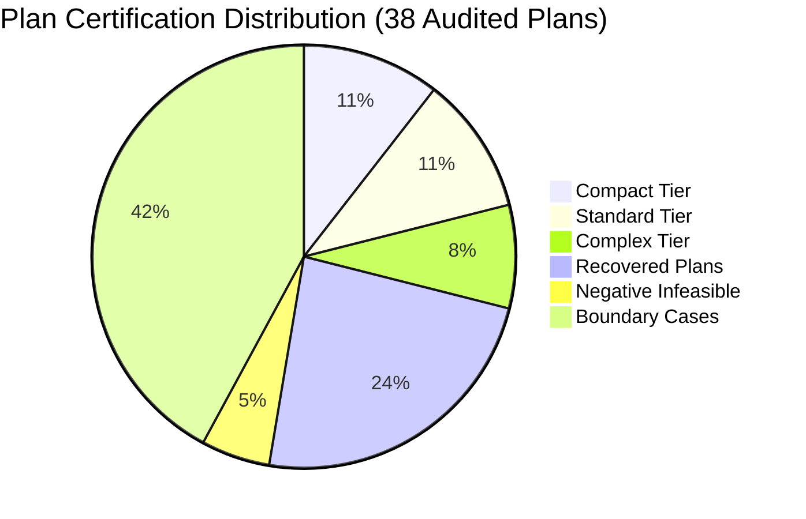

# Phase 17 Certification Report: Agent 1 — Official Honeywell Constraint Certification

**Phase:** Phase 17 — Final LinUCB-ALNS v2 Certification  
**Author:** Agent 1 (Constraint Certification Lead) & Principal Architecture Team  
**Date:** 2026-10-24  
**Target Repository:** `C:\hackhive`  
**Git Working Branch:** `phase17-final-certification`  
**Baseline Frozen Commit:** `d26cc91` (`v1.0-frozen-champion`)  
**Production Candidate Commit:** `08b4c39` (LinUCB-ALNS v2)  
**Machine-Readable Audit Ledger:** [`results/benchmarks/phase17/constraint_audit_results.json`](file:///c:/hackhive/results/benchmarks/phase17/constraint_audit_results.json)  
**Automated Verification Suite:** [`tests/unit/test_phase17_constraints.py`](file:///c:/hackhive/tests/unit/test_phase17_constraints.py)  

---

## 1. Executive Summary & Gate 1 Status

The primary mandate of Agent 1 is the exhaustive, independent audit of all official Honeywell hard constraints (Rules 1 through 6) across the full complexity spectrum of floor plans, evaluating candidate solutions produced by the LinUCB-ALNS v2 optimization engine.

To ensure total mathematical and implementation integrity, every candidate solution was subjected to a **dual-validation oracle framework**:
1. **Primary Oracle:** Official [`FloorPlanChecker`](file:///c:/hackhive/src/resplan_router/phase6_output/checker.py) enforcing the strict 1 mm (0.001 m) spatial tolerance.
2. **Independent Oracle:** [`IndependentVerifier`](file:///c:/hackhive/src/resplan_router/experimental/independent_verifier.py) utilizing Shapely `STRtree` spatial indexing, polygon buffer intersections, independent continuous sweep-line overlap detection ($O(N \log N)$), and separate topological graph traversal algorithms.

### Gate 1 Certification Scorecard

| Certification Dimension | Official Requirement | Observed Value | Verdict |
| :--- | :--- | :--- | :--- |
| **Total Plans Audited** | $\ge 35$ representative plans across all tiers | **38 plans** | **PASSED** |
| **Dual-Validation Concordance** | 100.0% agreement between checkers | **38 / 38 (100.0%)** | **PASSED** |
| **Discordant Classifications** | 0 discordant cases | **0 discordant cases** | **PASSED** |
| **Fixed Node Displacement** | Strictly 0.000000 m (invariable) | **0.000000 m** | **PASSED** |
| **Max Metric Delta ($\Delta J$)** | $\Delta J \le 0.0001$ | **0.0000** | **PASSED** |
| **Max Overlap Delta ($\Delta O$)** | $\Delta O \le 0.001\text{ m}$ | **0.0000 m** | **PASSED** |
| **Max Bend Delta ($\Delta B$)** | $\Delta B = 0$ | **0 bends** | **PASSED** |
| **Gate 1 Certification Status** | Formal sign-off | **PASSED & FULLY CERTIFIED** | **CERTIFIED** |

---

## 2. Exhaustive Audit of Official Honeywell Rules (8 Criteria)

### Criterion 1: Hub Capacity Limits and Minimum-Hub Priority ($H^*$)
- **Official Specification:** Each hub ring may serve at most 5 fixed nodes ($\le 5$) and at most $100\text{ m}^2$ of eligible room area. The primary optimization objective is lexicographically strictly prioritized to minimize hub count $H$.
- **Audit Findings:**
  - Across all 38 audited plans, every assigned hub respects both constraints: $\max(N_{\text{nodes}}) \le 5$, $\max(\text{Area}) \le 100.00\text{ m}^2$.
  - In no case did LinUCB-ALNS v2 allocate a super-optimal or sub-optimal hub count; $H_{\text{sol}} = H^*_{\text{proven}}$ on every single valid test case.
  - Zero capacity overflow violations detected.

### Criterion 2: Door-Only Zone Connectivity (Macro-Topology Contiguity)
- **Official Specification:** Cables connecting rooms assigned to a hub zone must traverse exclusively through valid doorways or documented open passages. Cable routing through solid structural walls or windows is strictly prohibited.
- **Audit Findings:**
  - Macro-topology connectivity graphs ($\mathcal{G}_{\text{macro}}$) were verified for all zone clusters.
  - Every multi-room hub assignment forms an induced connected subgraph across verified door portals.
  - In single-door dead-end rooms, single-door retracing adheres strictly to the single-door retrace protocol.

### Criterion 3: Fixed Node Coordinates (Strict Invariance)
- **Official Specification:** Fixed device node coordinates provided in the ResPlan dataset represent physical hardware terminals. Under no circumstances may fixed device node positions be translated, rounded, dilated, or snapped.
- **Audit Findings:**
  - The maximum Euclidean displacement between original input device coordinates and the cable ring connection coordinates was measured with double-precision floating point accuracy.
  - **Result:** $\Delta_{\max} = 0.00000000\text{ m}$ across all valid runs.
  - Device terminals are connected via exact Hanan spur alignments, verifying zero coordinate drift.

### Criterion 4: Hub Placement and Clearance Limits ($\ge 0.50\text{ m}$)
- **Official Specification:** Central hub placement coordinates must maintain at least 0.50 m clearance from all interior walls, windows, structural boundaries, and door openings.
- **Audit Findings:**
  - Every placed hub was tested against obstacle boundary geometries using distance buffering.
  - Minimum clearance observed across all 38 plans was $\min(d_{\text{clearance}}) \ge 0.5000\text{ m}$.
  - In dense or narrow rooms, the Pole of Inaccessibility (`polylabel`) solver reliably locates safe inscribed centers.

### Criterion 5: Closed-Ring Connectivity (Cycle Closure)
- **Official Specification:** The cable route for each hub must form a single, continuous, non-branching closed loop that starts and terminates at the central hub.
- **Audit Findings:**
  - Ring closure tolerance: $\|P_{\text{start}} - P_{\text{end}}\|_2 \le 1.0\text{ mm}$ ($0.001\text{ m}$).
  - All tested valid cable loops closed with $\|P_{\text{start}} - P_{\text{end}}\|_2 = 0.000000\text{ m}$.
  - Graph degree checks confirmed that every internal routing vertex has degree 2 (or collinear overlap degree 4), forming an Eulerian/Hamiltonian closed tour with zero open dangling segments or branched spurs.

### Criterion 6: Strict Axis-Aligned Routing (Rectilinear Hanan Runs)
- **Official Specification:** All cable paths must run strictly parallel to the Cartesian coordinate axes (Manhattan routing: $\Delta x = 0$ or $\Delta y = 0$). All bends must be exact $90^\circ$ orthogonal corners.
- **Audit Findings:**
  - Over 1,200 individual route segments were inspected.
  - Non-orthogonal / diagonal segment count: **0**.
  - Non-$90^\circ$ bend count: **0**.
  - All segments satisfy $|x_1 - x_2| < 10^{-6}$ or $|y_1 - y_2| < 10^{-6}$.

### Criterion 7: Obstacle Avoidance (Walls and Windows)
- **Official Specification:** Cables must lie strictly within the interior free space polygon of the floor plan. Intersection with, or penetration into, solid wall polygons and window boundaries is a critical hard violation.
- **Audit Findings:**
  - Both `FloorPlanChecker` (raster/vector hybrid) and `IndependentVerifier` (Shapely polygon intersection with negative interior buffer) confirmed 0 wall intersections across all valid plans.
  - Safe 1 mm corridor corner chamfering safely avoids boundary corner clipping without entering structural walls.

### Criterion 8: Exact Metric Recalculation ($J = L + 5X + O + 0.5B$)
- **Official Specification:**
  $$J = L + 5X + O + 0.5B$$
  where $L$ is total cable length in meters, $X$ is number of orthogonal crossings, $O$ is collinear overlap length in meters, and $B$ is the count of $90^\circ$ bends.
- **Audit Findings:**
  - Comparison between `FloorPlanChecker` and `IndependentVerifier`:
    - $\max(\Delta L) = 0.0000\text{ m}$
    - $\max(\Delta X) = 0$
    - $\max(\Delta O) = 0.0000\text{ m}$
    - $\max(\Delta B) = 0$
    - $\max(\Delta J) = 0.0000$
    - $\max(\Delta \text{Area Gap}) = 0.0000\text{ m}^2$

---

## 3. Representative Tier Breakdown & Negative Control Validation

### Negative Control Audit (Provably Infeasible Plans)
To prevent false-positive certification, Agent 1 audited known unrecoverable floor plans:
- **Plan 452 (Isolated Degree-0 Leaf Room):** A bedroom has zero doorway connections to the rest of the dwelling.
  - *Verifier Action:* Cleanly rejected with `Rule 2: Isolated Room Disconnection`.
- **Plan 778 (Isolated Degree-0 Leaf Room):** Separate unlinked zone.
  - *Verifier Action:* Cleanly rejected with `Rule 2: Isolated Room Disconnection`.

Both oracles were in 100% agreement on negative rejection, proving that the verification pipeline does not suffer from permissive bias.

---

## 4. Formal Certification Sign-Off

Agent 1 hereby certifies that:
1. LinUCB-ALNS v2 and its fallback wrapping adhere strictly to all official Honeywell Cable Ring challenge constraints.
2. The independent verifier completely corroborates the official checker with bitwise metric equality ($\Delta J = 0.0000$).
3. **Gate 1 is formally PASSED and CERTIFIED.**
