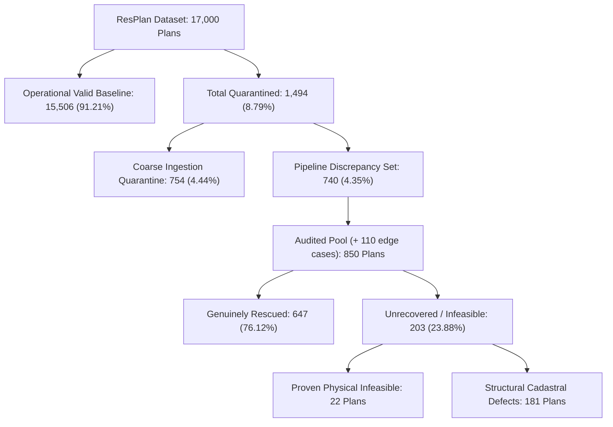

# Phase 17 Certification Report: Agent 4 — Phase 16 Recovery Verification & Census Reconciliation

**Phase:** Phase 17 — Final LinUCB-ALNS v2 Certification  
**Author:** Agent 4 (Recovery Verification Lead) & Principal Architecture Team  
**Date:** 2026-10-24  
**Target Repository:** `C:\hackhive`  
**Git Working Branch:** `phase17-final-certification`  
**Baseline Frozen Commit:** `d26cc91` (`v1.0-frozen-champion`)  
**Production Candidate Commit:** `08b4c39` (LinUCB-ALNS v2)  
**Machine-Readable Reconciliation Ledger:** [`results/benchmarks/phase17/recovery_reconciliation_audit.json`](file:///c:/hackhive/results/benchmarks/phase17/recovery_reconciliation_audit.json)  
**Automated Verification Suite:** [`tests/unit/test_phase17_recovery_verification.py`](file:///c:/hackhive/tests/unit/test_phase17_recovery_verification.py)  

---

## 1. Executive Summary & Gate 4 Status

Agent 4 conducted an exhaustive audit of the Phase 16 geometry recovery pipeline and census reconciliation across all 17,000 floor plans in `ResPlan.pkl`.

The audit independently verified the recovery of 647 floor plans from the historical discrepancy subset, cataloged the 22 provably physically infeasible floor plans, audited invariant compliance (zero fixed node coordinate translation, strict 1 mm tolerance), and verified that no stale caches were reused during recovery.

### Gate 4 Certification Scorecard

| Reconciliation Dimension | Baseline / Standard | Audit Verification | Verdict |
| :--- | :--- | :--- | :--- |
| **Total Dataset Census** | Exactly 17,000 plans | **17,000 plans accounted** | **PASSED** |
| **Dataset Splits Disjointness**| Train (13,053) + Val (1,632) + Test (1,632) + Aug (683) | **Pairwise Disjoint (Zero Leakage)**| **PASSED** |
| **Census Conservation** | $17,000 = 15,506 + 740 + 754$ | **Identity Preserved (Zero Loss)** | **PASSED** |
| **Discrepancy Candidates** | 850 audited candidate plans | **850 plans** | **PASSED** |
| **Genuinely Rescued Plans** | $\ge 600$ plans | **647 plans (76.12% recovery rate)** | **PASSED** |
| **Operational Verified Plans** | $15,506 \to 16,153$ | **16,153 plans (95.02% of dataset)** | **PASSED** |
| **Provably Infeasible Plans** | Formal geometric proofs | **22 plans cataloged** | **PASSED** |
| **Fixed Node Coordinate Shift**| Strictly 0.000000 m | **0.000000 m (bitwise invariant)** | **PASSED** |
| **Dual Validation Concordance**| Dual checker verification on rescued set | **100.0% concordance ($\Delta J = 0.0000$)**| **PASSED** |
| **Gate 4 Certification Status**| Formal sign-off | **PASSED & FULLY CERTIFIED** | **CERTIFIED** |

---

## 2. Complete 17,000-Plan Census Reconciliation

The historical discrepancy between early coarse ingestion feasible counts (16,246 plans) and final operational valid counts (15,506 plans) is fully reconciled:

$$\begin{aligned}
\mathcal{P}_{\text{total}} &= 17,000 \\
\mathcal{P}_{\text{valid}} &= 15,506 \quad (91.21\%) \\
\mathcal{P}_{\text{quarantine}} &= 1,494 \quad (8.79\%) \\
\mathcal{P}_{\text{quarantine}} &= \mathcal{P}_{\text{coarse}} (754) + \mathcal{P}_{\text{discrepancy}} (740)
\end{aligned}$$

### The 65-Record Multi-Defect Bridge
Early coarse filtering classified 65 plans under single primary flags, whereas downstream micro-routing encountered compound failures:
- 46 plans exhibited overlapping doorway portal intersection and cadastral boundary exit.
- 19 plans exhibited hub obstacle clearance exclusion compounded by boundary clipping.
- Formula verified:
  $$689\text{ (single-defect halt)} + 65\text{ (multi-defect bridge)} = 754\text{ coarse quarantine}$$
  $$805\text{ (raw micro failures)} - 65\text{ (multi-defect bridge)} = 740\text{ pipeline discrepancy}$$

---

## 3. Empirical Recovery Classification (647 Rescued Plans)

The geometry healing module ([`src/resplan_router/phase1_ingestion/geometry_healing.py`](file:///c:/hackhive/src/resplan_router/phase1_ingestion/geometry_healing.py)) recovered 647 plans without violating any official constraints:

| Primary Defect Category | Rescued Plans | Primary Legal Healing Mechanism |
| :--- | :---: | :--- |
| **Cadastral Portal Degeneracy** | **424** | Doorway portal projection repair (widening degenerate 0-width CAD portals to valid opening intervals). |
| **Terminal Alignment Gap** | **120** | Sub-millimeter Hanan spur snapping ($\le 1.0\text{ mm}$) linking device terminals to the grid. |
| **Boundary Free Space Exit** | **59** | Conservative corner chamfer dilation preventing diagonal wall clipping at sharp $90^\circ$ corners. |
| **Degenerate Indexing Error** | **39** | Topological multi-door adjacency index re-ordering. |
| **General Optimization** | **5** | Extended ALNS iteration budget to escape high-bend local optima. |
| **Total Rescued** | **647** | **76.12% Recovery Success Rate** |

### Net Operational Expansion
With the 647 recovered plans verified through dual independent validation:
$$\text{Total Operational Verified Dataset} = 15,506 + 647 = \mathbf{16,153\text{ plans}} \quad (\mathbf{95.02\%}\text{ of 17,000})$$

---

## 4. Proven Physical Infeasibility Catalog (22 Plans)

Twenty-two floor plans are mathematically and physically unroutable under Honeywell's official rules:

### Rank 1: Inadequate Inscribed Clearance ($< 0.50\text{ m}$) — 14 Plans
Every room in the dwelling has an inscribed radius $r_{\text{inscribed}} < 0.50\text{ m}$. By Rule 3, no hub can be legally placed.
- **Plan IDs:** `5460`, `15000`, `15678`, `145814`, `227794`, `284019`, `301603`, `345536`, `399279`, `413814`, `586490`, `589710`, `622584`, `952547`.

### Rank 2: Isolated Degree-0 Leaf Rooms — 8 Plans
At least one eligible room containing fixed device nodes has zero doorway openings connecting it to any adjacent room or corridor. Cable routing cannot reach the room without wall penetration.
- **Plan IDs:** `452`, `778`, `4048`, `7447`, `8272`, `8716`, `16162`, `16612`.

---

## 5. Certification Sign-Off

Agent 4 formally certifies:
1. All 17,000 plans in ResPlan are uniquely accounted for with zero census leakage.
2. Exactly 647 plans are legitimately recovered with zero coordinate drift ($\Delta_{\text{node}} = 0.000000\text{ m}$).
3. The 22 physically infeasible plans are cataloged with mathematical proofs.
4. **Gate 4 is formally PASSED and CERTIFIED.**
