# Phase 17 — Final LinUCB-ALNS v2 Certification: Execution Dashboard

**Project:** Honeywell Residential Cable Ring Optimization — Phase 17  
**Date:** 24 October 2026  
**Status:** **PHASE 17 COMPLETED & CERTIFIED — ALL 5 GATES PASSED**  
**Active Working Branch:** [`phase17-final-certification`](file:///c:/hackhive)  
**Production Release Tag:** `v2.0-certified-production`  
**Frozen Baseline:** `v1.0-frozen-champion` (Git Commit `d26cc91`)  
**Production Candidate:** `LinUCB-ALNS v2` + `ProductionFallbackOptimizer` + `GeometryHealingEngine` (Git Commit `08b4c39`)  
**Remote Origin:** [`https://github.com/KPB040107/honeywell-cable-ring-optimization`](https://github.com/KPB040107/honeywell-cable-ring-optimization)  

---

## 1. Phase 17 Objectives & Certification Scorecard

| Certification Gate | Subagent Lead | Primary Deliverables | Status | Key Metric / Result |
| :---: | :--- | :--- | :---: | :--- |
| **Gate 1** | **Agent 1: Constraint Certification** | [`reports/phase17_agent1_constraint_certification.md`](file:///c:/hackhive/reports/phase17_agent1_constraint_certification.md) [`results/benchmarks/phase17/constraint_audit_results.json`](file:///c:/hackhive/results/benchmarks/phase17/constraint_audit_results.json) [`tests/unit/test_phase17_constraints.py`](file:///c:/hackhive/tests/unit/test_phase17_constraints.py) | **PASSED & CERTIFIED** | 100.0% Dual Concordance (38/38 plans); $\Delta_{\text{node}} = 0.000000\text{ m}$; $\Delta J = 0.0000$. |
| **Gate 2** | **Agent 2: Hub-Count Optimality** | [`reports/phase17_agent2_hub_optimality.md`](file:///c:/hackhive/reports/phase17_agent2_hub_optimality.md) [`results/benchmarks/phase17/hub_optimality_certificates.json`](file:///c:/hackhive/results/benchmarks/phase17/hub_optimality_certificates.json) [`src/resplan_router/experimental/hub_optimality_verifier.py`](file:///c:/hackhive/src/resplan_router/experimental/hub_optimality_verifier.py) [`tests/unit/test_phase17_hub_optimality.py`](file:///c:/hackhive/tests/unit/test_phase17_hub_optimality.py) | **PASSED & CERTIFIED** | 100.0% agreement between Bitmask DP and CP-SAT on $H^*$; Decoupling Theorem ($H^* \not\Rightarrow J^*$) mathematically proven. |
| **Gate 3** | **Agent 3: Production Reliability** | [`reports/phase17_agent3_production_reliability.md`](file:///c:/hackhive/reports/phase17_agent3_production_reliability.md) [`results/benchmarks/phase17/production_reliability_benchmark.json`](file:///c:/hackhive/results/benchmarks/phase17/production_reliability_benchmark.json) [`tests/unit/test_phase17_production_reliability.py`](file:///c:/hackhive/tests/unit/test_phase17_production_reliability.py) | **PASSED & CERTIFIED** | Arbitration overhead: $1.365\ \mu\text{s}$ (mean); 7/7 fault injection modes passed; 6 P-core worker pool affinity. |
| **Gate 4** | **Agent 4: Recovery Verification** | [`reports/phase17_agent4_recovery_verification.md`](file:///c:/hackhive/reports/phase17_agent4_recovery_verification.md) [`results/benchmarks/phase17/recovery_reconciliation_audit.json`](file:///c:/hackhive/results/benchmarks/phase17/recovery_reconciliation_audit.json) [`tests/unit/test_phase17_recovery_verification.py`](file:///c:/hackhive/tests/unit/test_phase17_recovery_verification.py) | **PASSED & CERTIFIED** | Census identity reconciled ($17,000 = 15,506 + 740 + 754$); 647 rescued plans ($76.12\%$); operational dataset: 16,153 ($95.02\%$). |
| **Gate 5** | **Agent 5: Final Research Audit** | [`reports/phase17_agent5_research_audit.md`](file:///c:/hackhive/reports/phase17_agent5_research_audit.md) [`results/benchmarks/phase17/research_audit_summary.json`](file:///c:/hackhive/results/benchmarks/phase17/research_audit_summary.json) [`tests/unit/test_phase17_research_audit.py`](file:///c:/hackhive/tests/unit/test_phase17_research_audit.py) | **PASSED & CERTIFIED** | Zero test split leakage ($N=0$); paired tests replicated ($t=1.472, W=247.5, r_{\text{rb}}=0.786$); matched budgets confirmed. |

---

## 2. Master Deliverables Architecture

```mermaid
flowchart TD
    MCR["Master Certification Report\nreports/phase17_master_certification_report.md"] --> G1["Gate 1: Constraint Audit\nreports/phase17_agent1_constraint_certification.md\nresults/benchmarks/phase17/constraint_audit_results.json\ntests/unit/test_phase17_constraints.py"]
    MCR --> G2["Gate 2: Hub Optimality\nreports/phase17_agent2_hub_optimality.md\nresults/benchmarks/phase17/hub_optimality_certificates.json\ntests/unit/test_phase17_hub_optimality.py"]
    MCR --> G3["Gate 3: Production Reliability\nreports/phase17_agent3_production_reliability.md\nresults/benchmarks/phase17/production_reliability_benchmark.json\ntests/unit/test_phase17_production_reliability.py"]
    MCR --> G4["Gate 4: Recovery Reconciliation\nreports/phase17_agent4_recovery_verification.md\nresults/benchmarks/phase17/recovery_reconciliation_audit.json\ntests/unit/test_phase17_recovery_verification.py"]
    MCR --> G5["Gate 5: Research & Statistical Audit\nreports/phase17_agent5_research_audit.md\nresults/benchmarks/phase17/research_audit_summary.json\ntests/unit/test_phase17_research_audit.py"]
    
    MCR --> Release["Git Release Tag: v2.0-certified-production\nAuthorizes Phase 18 Full 17,000-Plan Execution"]
```

---

## 3. Production Deployment Sign-Off

The system is certified for full-dataset batch execution under the following parameters:
- **Optimizer Engine:** `ProductionFallbackOptimizer(candidate_opt=LinUCB_ALNS_V2Optimizer(), fallback_opt=ALNSLinUCBOptimizer())`
- **Worker Allocation:** 6 Worker Processes pinned to Performance Cores (0–11) on Intel Core i5-13450HX.
- **Per-Plan Timeout:** 5.0 seconds with 25 iterations.
- **Tolerances:** Strict 1.0 mm ($0.0010\text{ m}$) spatial tolerance, $0.5000\text{ m}$ hub obstacle clearance.
- **Checkpointing:** Atomic JSON persistence every 50 plans.
