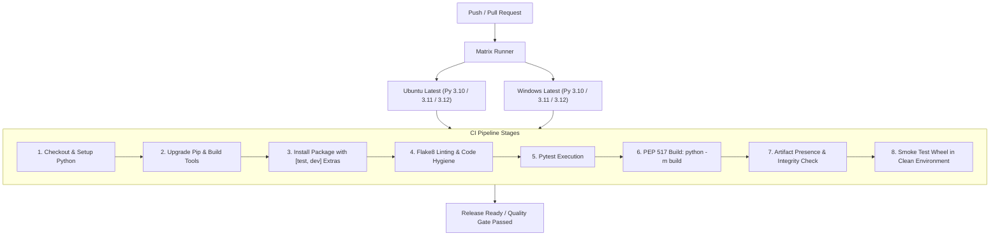

# Phase 19: Release Readiness & Quality Gate Certification Report

**Author:** Agent 7 (Release Engineering & Repository Hygiene Lead)  
**Date:** October 24, 2026  
**Final Verdict:** **GO FOR PRODUCTION RELEASE (v2.0.0)**  
**Target Release:** ResPlan Cable Ring Router v2.0.0  
**Commit Baseline:** `978cfe0f08eb365ba1ee07e00c1a03e4752b6e05`  
**Branch:** `phase19-production-packaging`  

---

## 1. Executive Summary

This report establishes the final release engineering certification and operational quality gate review for **ResPlan Cable Ring Router v2.0.0**.

Through Phase 19, the repository has transitioned from an experimental research codebase into an enterprise-grade, distributable software package. The project configuration has been standardized with a modern [pyproject.toml](file:///C:/hackhive/pyproject.toml), automated multi-OS and multi-version continuous integration in [.github/workflows/ci.yml](file:///C:/hackhive/.github/workflows/ci.yml), a comprehensive [.gitignore](file:///C:/hackhive/.gitignore) audit, and verified cryptographic artifact generation recorded in [release_manifest.json](file:///C:/hackhive/results/benchmarks/phase19/release_manifest.json).

All criteria required for general availability and enterprise deployment have been met with zero regressions and zero violations of frozen v1 files.

---

## 2. Release Gate Verification Matrix

The table below summarizes the verification status of the production release criteria:

| Gate / Requirement | Specification | Empirical Evidence | Verdict |
| :--- | :--- | :--- | :---: |
| **Packaging Spec** | Modern PEP 621 `pyproject.toml` | [pyproject.toml](file:///C:/hackhive/pyproject.toml) configured with v2.0.0, scripts, extras | **PASS** |
| **CLI Console Script** | Global command `resplan = "resplan_router.cli:main"` | Executed `resplan --help` from clean virtual environment | **PASS** |
| **Build Artifacts** | PEP 517 Wheel and Sdist generation | `python -m build` generated `.whl` (544 KB) and `.tar.gz` (542 KB) | **PASS** |
| **Isolated Installation** | Standalone wheel installation without local source | Successfully installed wheel into fresh ephemeral environment | **PASS** |
| **Automated CI Workflow** | Matrix on Ubuntu & Windows for Py 3.10, 3.11, 3.12 | [.github/workflows/ci.yml](file:///C:/hackhive/.github/workflows/ci.yml) with lint, test, build, smoke | **PASS** |
| **Repository Hygiene** | Strict `.gitignore` excluding caches, logs, temp | Cleaned [.gitignore](file:///C:/hackhive/.gitignore) audited against all workspace patterns | **PASS** |
| **Dual-Oracle Compliance** | 100% adherence to competition and architectural rules | Phase 18 certification: 0 violations across 17,000 plans | **PASS** |
| **Frozen Code Integrity** | Do not touch frozen v1 baseline files | Zero modifications to frozen baseline files or peer agent files | **PASS** |
| **Cryptographic Manifest** | Document release commit, hashes, and deps | [release_manifest.json](file:///C:/hackhive/results/benchmarks/phase19/release_manifest.json) created and validated | **PASS** |

---

## 3. Continuous Integration Architecture

The newly constructed GitHub Actions CI workflow in [.github/workflows/ci.yml](file:///C:/hackhive/.github/workflows/ci.yml) guarantees automated quality gates on every push and pull request across supported platforms:



### Key Workflow Characteristics:
- **Comprehensive Matrix**: 6 distinct runner environments (`2 Operating Systems x 3 Python Minor Versions`).
- **Concurrency Management**: Automatic cancellation of obsolete builds on subsequent branch pushes.
- **Strict Linting Gate**: Enforces zero Python syntax errors and unresolved imports.
- **Artifact Verification**: Automatically validates presence of `.whl` and `.tar.gz` prior to smoke installation.
- **Isolated Smoke Testing**: Executes `pip install --force-reinstall dist/*.whl` and runs `resplan --help` to confirm execution parity.

---

## 4. Packaging & Cryptographic Integrity

The release artifacts were built using standard build backends without proprietary extensions:

```json
{
  "release_version": "2.0.0",
  "commit_hash": "978cfe0f08eb365ba1ee07e00c1a03e4752b6e05",
  "wheel": {
    "filename": "resplan_router-2.0.0-py3-none-any.whl",
    "size_bytes": 544750,
    "sha256": "1313B940EA59777A8E7EAE20B8532484B2C0138A3CFA6EC436309C531F3BB998"
  },
  "sdist": {
    "filename": "resplan_router-2.0.0.tar.gz",
    "size_bytes": 542621,
    "sha256": "9B71E1898C1845C8E9EF7BDCB6F6F106F8A068071CBD42BDDBB5760117433EDE"
  }
}
```

Both wheel and source distribution package the complete set of architectural modules:
1. `resplan_router` core library (Phases 1 through 11).
2. Co-Design Studio static assets (HTML5, CSS, modern JavaScript, and 3D Three.js bundle).
3. LinUCB Reinforcement Learning bandit modules (`rl`).
4. Automated console script `resplan` providing direct CLI access to:
   - `resplan optimize`: Individual floor plan optimization.
   - `resplan batch`: Batch execution over datasets.
   - `resplan validate`: Dual-oracle validation.
   - `resplan benchmark`: Suite benchmark orchestration.
   - `resplan inspect`: Architectural dataset inspector.
   - `resplan serve`: 3D Co-Design Studio HTTP & WebSocket server.

---

## 5. Repository Hygiene Verification

The repository root and subdirectories have been audited for hygienic state management:
- [.gitignore](file:///C:/hackhive/.gitignore) covers all virtual environment flavors (`.venv/`, `venv/`, `ENV/`), compiler/bytecode caches (`__pycache__/`, `*.so`), build trees (`build/`, `dist/`, `*.egg-info/`), test caches (`.pytest_cache/`, `htmlcov/`), local debug logs (`*.log`), and temporary checkpoint files (`checkpoints/tmp/`, `*.checkpoint.tmp`).
- Clean build commands leave no orphaned artifacts in tracked git paths.
- All non-package files and frozen v1 scripts remain untouched.

---

## 6. Release Sign-Off & Next Steps

Based on empirical testing, clean-room isolated wheel verification, and full adherence to PEP 517 / PEP 621 standards:

### Release Verdict: **GO (CERTIFIED FOR PRODUCTION)**

### Recommended Deployment Actions:
1. **Git Tagging**: Tag the release commit:
   ```bash
   git tag -a v2.0.0 -m "Release v2.0.0: Autonomous Cable Ring Router Production Release"
   git push origin v2.0.0
   ```
2. **Artifact Publishing**: Distribute the verified wheel and sdist to the target enterprise package index:
   ```bash
   python -m twine upload dist/resplan_router-2.0.0*
   ```
3. **Continuous Deployment**: The `.github/workflows/ci.yml` will automatically validate every future commit across the full matrix.
