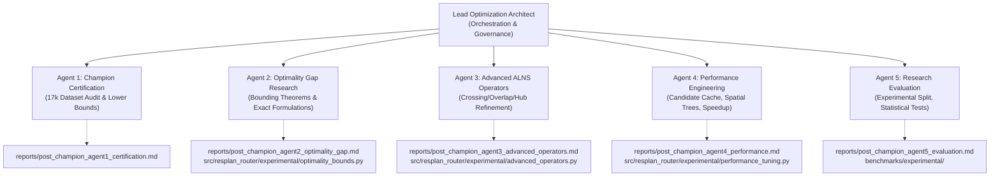

# Post-Champion Research Roadmap & Multi-Agent Execution Dashboard

**Project:** Honeywell Residential Cable Ring Optimization — Post-Champion Research  
**Date:** 24 October 2026  
**Status:** **PHASE 1 INITIATED: 5 PARALLEL RESEARCH SUBAGENTS ACTIVE**  
**Frozen Baseline Tag:** `v1.0-frozen-champion` (Commit `d26cc91`)  
**Active Development Branch:** [`post-champion-research`](file:///c:/hackhive)  
**Remote Repository:** [`https://github.com/KPB040107/honeywell-cable-ring-optimization`](https://github.com/KPB040107/honeywell-cable-ring-optimization)  

---

## 1. Research Objectives & Governance Invariant

The current benchmark champion is **LinUCB-ALNS**, integrated with exact 0-1 set-partitioning Bitmask DP, turn-penalized Hanan A* routing, and exact Held-Karp TSP tour sequencing.

### The Objective
Determine how close the current champion is to the theoretical global optimum, explore advanced routing operators and performance speedups, and quantify the optimality gap without compromising correctness or altering the frozen champion baseline.

### Core Governance Rules
1. **Immutable Champion Baseline:** The core production codebase (`src/resplan_router/optimizers/alns_linucb.py`, `portfolio_hybrid.py`, `bitmask_dp.py`, `hanan_grid.py`, `tsp_solver.py`, and `checker.py`) is frozen. All experimental modifications must live in `src/resplan_router/experimental/` and `benchmarks/experimental/`.
2. **Lexicographical Objective Priority:** Hard rule feasibility ($G=0$) $\succ$ Minimum Hub Count ($H$) $\succ$ Minimum Routing Cost ($J = L + 5X + O + 0.5B$) $\succ$ Area Gap ($\Delta A_{\text{gap}}$). Under no circumstance may an improvement increase $H$ to reduce $J$.
3. **Strict Experimental Hygiene:** The frozen 1,632-plan held-out test split must not be reused for exploratory hyperparameter tuning. All experiments must use dedicated experimental validation splits or nested k-fold subsets.
4. **Independent Oracle Authority:** [`FloorPlanChecker`](file:///c:/hackhive/src/resplan_router/phase6_output/checker.py) at $1\text{ mm}$ tolerance is the sole arbiter of validity and scoring.

---

## 2. Multi-Agent Subsystem Architecture & File Ownership

Five specialized research subagents are executing concurrently with strict non-overlapping file ownership:

### Detailed Agent Mandates & Deliverables

| Agent | Specialized Role | Conversation ID | Assigned Mandate | Dedicated File Ownership |
| :---: | :--- | :---: | :--- | :--- |
| **Agent 1** | **Champion Certification Lead** | `5d5d8769-79d4-466e-95dd-155c995db945` | Complete audit of 17,000 plans; verify 15,506 valid / 1,494 quarantined breakdown; verify lower-bound certificates; check cache integrity. | `reports/post_champion_agent1_certification.md` |
| **Agent 2** | **Optimality Gap Research Lead** | `8dbddec0-2a02-498c-8ec1-854c76e1d83e` | Derive mathematical lower bounds ($J_{\text{LB}}$) via 1-tree / rectilinear Steiner relaxations; evaluate exact CP-SAT/ILP on small plans; compute absolute and relative optimality gaps. | `reports/post_champion_agent2_optimality_gap.md`, `src/resplan_router/experimental/optimality_bounds.py` |
| **Agent 3** | **Advanced ALNS Operators Lead** | `a8908382-ea88-4c5e-a3c0-955f123f4df8` | Design crossing-aware route reconstruction, overlap-aware rerouting, continuous hub-position refinement, alternative minimum-hub partitions, and 3-opt/Or-opt ring search. | `reports/post_champion_agent3_advanced_operators.md`, `src/resplan_router/experimental/advanced_operators.py` |
| **Agent 4** | **Performance Engineering Lead** | `35ef247e-f538-4775-b109-cb94c9f2d448` | Profile high-latency floor plans; implement route candidate caching, STRtree spatial index filtering, incremental delta-cost evaluation, and worker process affinity. | `reports/post_champion_agent4_performance.md`, `src/resplan_router/experimental/performance_tuning.py` |
| **Agent 5** | **Research Evaluation Lead** | `85a1b648-a0c5-43ac-b2ed-9298b361abe6` | Construct dedicated experimental validation partition (500 plans); establish matched-budget paired comparison suite; execute Wilcoxon & bootstrap statistical testing. | `reports/post_champion_agent5_evaluation.md`, `benchmarks/experimental/` |

---

## 3. Execution Gates & Road Map

1. **Gate 1: Champion Preservation & Certification (ACTIVE):**
   - Frozen tag `v1.0-frozen-champion` pushed.
   - Agent 1 completes independent audit of all 17,000 plans.
2. **Gate 2: Independent Optimality Gap & Operator Research (ACTIVE):**
   - Agent 2 computes bounds on representative benchmark plans ($N \in \{51, 64, 78, 239, 531, 14433\}$).
   - Agent 3 prototypes surgical ALNS operators.
   - Agent 4 measures profiling bottlenecks and implements spatial caching.
3. **Gate 3: Experimental Validation & Candidate Filtering:**
   - Agent 5 benchmarks candidate operators on the independent experimental split.
   - Reject any operator that degrades $H$ or feasibility.
4. **Gate 4: Integration & Correctness Verification:**
   - Merge winning non-conflicting operators into the experimental engine.
   - Run complete 445-item test suite to guarantee zero regression.
5. **Gate 5: Final Post-Champion Synthesis:**
   - Publish master optimality gap and post-champion research findings.
