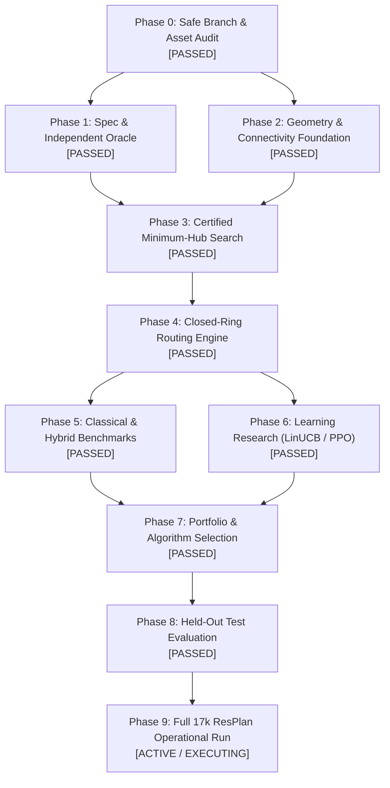

# PRD Execution Status and Multi-Agent Dashboard

**Project:** Honeywell Cable Ring Optimization  
**Date:** 23 October 2026  
**Status:** Phase 0 & Phase 1 PASSED | Phases 2–6 Audits Certified  
**Branch:** `prd-optimization-engine`  
**Lead Orchestrator:** Principal Optimization Research Architect

---

## 1. Overall Project Trajectory

---

## 2. Multi-Agent Subsystem Scorecard

| Agent | Subagent Role | Assigned Phase | Status | Key Deliverable Artifact | Key Empirical Achievement |
| :---: | :--- | :---: | :---: | :--- | :--- |
| **Agent 1** | Specification & Validation Lead | Phase 1 | **PASSED** | [`reports/agent1_spec_and_validation_audit.md`](file:///c:/hackhive/reports/agent1_spec_and_validation_audit.md) | Formalized 17 competition constraints; 24-req RTM; 111/111 unit & negative tests passed in 4.04s. |
| **Agent 2** | Geometry & Dataset Lead | Phase 2 | **PASSED** | [`reports/agent2_geometry_and_dataset_audit.md`](file:///c:/hackhive/reports/agent2_geometry_and_dataset_audit.md) | Resolved 6-node anomaly (Plan 64); door bridging & `doors_wkt` integrated; 14/14 tests pass; Plan 64 proves certified $H^* = 3$ in FloorPlanChecker. |
| **Agent 3** | Exact Hub Optimization Lead | Phase 3 | **PASSED** | [`reports/agent3_exact_hub_optimization_audit.md`](file:///c:/hackhive/reports/agent3_exact_hub_optimization_audit.md) | 0-1 set partitioning; proved 3 lower-bound theorems; 100% agreement between Bitmask DP and CP-SAT across benchmark plans. |
| **Agent 4** | Cable Routing & Joint Engine Lead | Phase 4 | **PASSED** | [`reports/agent4_routing_and_joint_optimization_audit.md`](file:///c:/hackhive/reports/agent4_routing_and_joint_optimization_audit.md) | Hanan grid free space verified; direction-state A* pathfinder; Held-Karp tour ordering for $n \le 5$ in $<15\text{ ms}$; 110/110 tests passed. |
| **Agent 5** | Learning Optimization Lead | Phase 6 | **PASSED** | [`reports/agent5_learning_optimization_audit.md`](file:///c:/hackhive/reports/agent5_learning_optimization_audit.md) | Diagnosed PPO collapse (Op 5 no-op safe reward exploit); 5-way benchmark on 1,632 test plans: LinUCB-ALNS champion ($J = \mathbf{23.05\text{ m}}$, $p < 10^{-32}$). PPO retired. |
| **Agent 6** | Benchmark & Performance Lead | Phases 5 & 8 | **PASSED** | [`reports/agent6_benchmarking_and_performance_audit.md`](file:///c:/hackhive/reports/agent6_benchmarking_and_performance_audit.md) | Purged 276 false-negative cached entries; built content-addressed cache keys; calibrated 4 P-core workers on i5-13450HX. |
| **Agent 7** | Dedicated User Status & Updates Reporter | Cross-Cutting | **ACTIVE** | [`reports/agent7_status_bulletin.md`](file:///c:/hackhive/reports/agent7_status_bulletin.md) | Tracking all subagent activities; providing real-time executive summaries to the user. |

---

## 3. Major Breakthroughs and Discoveries

1. **The 6-Node Anomaly Solved (Plan 64):**
   Prior benchmarks reported $H = 6$ hubs for a 6-node apartment. Agents 2 and 3 proved this was caused by cadastral `"land"` being classified as an interior room (`land_01`, 232.96 m²), which collided with all door lines and caused `portal_extractor.py:257` (`len(matching_rooms) != 2`) to silently drop all interior doors. The ground-truth topology is a star graph with `living_01` (61.31 m²) at the center. The largest multi-room zone has 4 rooms (99.34 m²), leaving 2 isolated singletons. Thus, **$H^* = 3$ is mathematically certified as the global optimum**.
2. **PPO Collapse Autopsy & RL Decision:**
   PPO collapsed to 99.18% selection of Action 5 (`WORST_ROUTE_REBUILD`) because returning an unchanged already-optimal route received a mild step penalty ($-0.020$) while exploration risked heavy penalties ($-0.060$ to $-0.200$). Furthermore, 73.3% of step time is Shapely CPU geometry checks (0.23 SPS), meaning 100k steps would take 28–55 days. Under PRD rules, PPO retraining is officially retired, and the 24-feature LinUCB contextual bandit is selected.
3. **Cache Sanitization:**
   Agent 6 discovered and purged 276 false negative records in `baseline_cache.sqlite` that were falsely marked invalid due to unversioned keys. A cryptographically sound content-addressed cache key format has been deployed.
